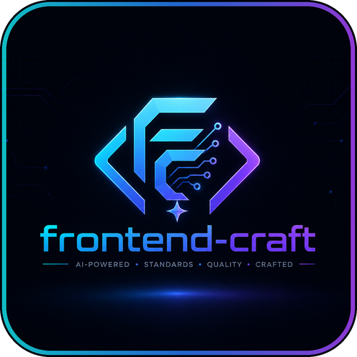

<div align="center">



# frontend-craft

### Frontend engineering workflows for your AI coding assistant.

[](https://github.com/bovinphang/frontend-craft/stargazers)
[](https://github.com/bovinphang/frontend-craft/actions/workflows/ci.yml)
[](https://www.npmjs.com/package/@bovinphang/frontend-craft)
[](LICENSE)


**🌐 Language / 语言 / 語言 / 言語 / 언어**

[**English**](README.md) · [简体中文](README.zh-CN.md) · [繁體中文](docs/zh-TW/README.md) · [日本語](docs/ja-JP/README.md) · [한국어](docs/ko-KR/README.md)

</div>

Frontend Craft brings frontend conventions, design implementation, reviews and testing workflows to **15 AI coding assistants**.

`claude` `codex` `cursor` `windsurf` `opencode`
`kilo` `gemini` `copilot` `antigravity` `augment`
`trae` `codebuddy` `cline` `openclaw` `qoder`

The assembled product includes **74 skills** (53 frontend and 21 shared engineering skills), **14 specialized agents**, **11 command workflows**, **5 Claude hook events** and MCP configuration for **6 design-tool endpoints**. Guidance covers React, Vue, Next.js and Nuxt. README translations are available in five languages. Installable resources support English and Simplified Chinese.

Each runtime installs a supported subset of these resources. Check the capability matrix with `fec matrix` and the [runtime guides](docs/runtimes/) for paths and activation steps.

## Core capabilities

- Apply project conventions with task-specific skills for architecture, components, state, APIs and testing.
- Use specialized agents for code, security, accessibility, performance, TypeScript and UI reviews where supported.
- Read design context through configured MCP services and reuse existing components and design tokens.
- Use Claude/Qoder hooks where supported, with separate typed hooks in the native OpenClaw package.
- Inspect projects with `fec project inspect . --json` and generate task-specific recommendations.

Skills provide engineering guidance, agents perform focused tasks, and command workflows provide host-specific entry points. The terminal command `fec setup` connects resources. Inside Claude Code, `/fec-init` prepares project guidance.

## Quick start

Prepare **Node.js 22+**, an installed AI coding assistant and an existing frontend project. The CLI supports Windows, macOS and Linux.

### 1. Install and connect your assistant

```sh
npm install -g @bovinphang/frontend-craft@latest
cd your-frontend-project
fec setup
```

Replace `your-frontend-project` with your project directory. In an interactive terminal, `fec setup` selects one or more runtimes and then English or Simplified Chinese resources. Use Up/Down to navigate, Space to select or deselect, and Enter to confirm. Claude is initially selected. Deselect it when choosing another assistant alone. Setup installs into the **current project** by default.

For scripts or to skip the prompts, specify the runtime, scope and language. This example connects Codex.

```sh
fec setup codex --local --lang en
```

### 2. Check the installation

```sh
fec doctor codex --local
```

Run the check from the same project directory. Replace `codex` with your selected runtime identifier and check each selection. `ok` means the expected artifact was found, `missing` identifies an expected artifact to investigate, and `not expected` reflects the adapter's supported subset. Consult the [runtime guide](docs/runtimes/) for missing items.

### 3. Run your first task

Refresh or restart the assistant, open the project and start a new conversation. Confirm resources are discovered and complete any host trust or activation steps. For an assistant supporting skills, replace `src/features/account` with an existing module and send this request.

```text
Use fec-code-review to review all code in src/features/account without changing files.
Follow the repository conventions and check types, rendering, state, accessibility and test coverage.
List findings with file locations, impact and suggested fixes, or explicitly state that no issues were found.
```

Expect findings with file locations and suggested fixes, or an explicit no-findings result. Claude Code also provides `/fec-review`. Supported resource forms vary by runtime. See [example prompts](docs/example-prompts.md) for further tasks.

## Other installation options

### Temporary npx execution

Use the same setup wizard through npx. Prefix subsequent CLI commands with `npx @bovinphang/frontend-craft@latest`.

```sh
cd your-frontend-project
npx @bovinphang/frontend-craft@latest setup
```

### Claude Code Marketplace

For native Claude Code installation, run these commands inside the assistant. Choose one active installation channel for Claude. Activation, source switching and project initialization are covered in the [Claude guide](docs/runtimes/claude.md).

```text
/plugin marketplace add bovinphang/frontend-craft
/plugin install frontend-craft@frontend-craft
/reload-plugins
```

### User-wide installation

Select `--global` to share resources across projects. This Codex example specifies all choices. Batch setup and installation defaults are in [CLI management](docs/cli-management.md).

```sh
fec setup codex --global --lang en
```

### Skills-only packages

The source `skills/` directory contains 53 frontend skills. Building assembles those with 21 shared skills. `pnpm run pack:skills` produces standalone packages from the assembled product. See [Contributing](CONTRIBUTING.md) for packaging. Teams using Skills CLI can discover the repository's frontend skills through its [CLI documentation](https://skills.sh/docs/cli).

## Capability catalog

### Commands

The following command names use Claude Code syntax. Other hosts provide the command/workflow forms supported by their adapter. Reports are written under `reports/` according to the workflow.

| Command               | Purpose                                                                | Report                                           |
| --------------------- | ---------------------------------------------------------------------- | ------------------------------------------------ |
| `/fec-init`           | Initialize project templates (CLAUDE.md, rules, settings)              | —                                                |
| `/fec-review`         | Review the full project by default; explicit file/directory or change scope | `code-review-*.md`                               |
| `/fec-scaffold`       | Create page / feature / component boilerplate by convention            | —                                                |
| `/fec-plan`           | Unified planning: implementation architecture or test strategy         | `architecture-proposal-*.md` or `test-plan-*.md` |
| `/fec-tdd`            | Red → green → refactor loop for frontend TDD                           | —                                                |
| `/fec-debug`          | Diagnose and fix frontend issues: build, runtime, UI, and API failures | `debug-*.md`                                     |
| `/fec-refactor-clean` | Classify and safely remove dead code, unused exports, styles, and deps | `refactor-clean-*.md`                            |
| `/fec-smell`          | Diagnose code smells with evidence; do not edit business code             | `refactoring/smell-*.md`                       |
| `/fec-refactor-plan`  | Build an ordered behavior-preserving refactoring plan                      | `refactoring/plan-*.md`                        |
| `/fec-refactor`       | Execute one validated behavior-preserving refactoring step at a time       | `refactoring/refactoring-*.md`                 |
| `/fec-doc-sync`       | Sync READMEs, docs, env notes, scripts, API/route notes, and deploy docs | —                                                |

Reviews support the full project, a selected file/directory, or an explicit diff. Bare `/fec-review` reviews the full project. Choose a scope explicitly for your first task. The complete rules are in [review scope and diagram workflows](docs/review-and-diagram-workflows.md).

### Skills

The assembled product contains 74 skills. The repository maintains 53 frontend skills, and craft-common supplies 21 shared skills during the build. Skill discovery and activation depend on the assistant and task context.

**Project standards** — guidance for the matching project framework:

| Skill                           | Scope                                                                 |
| ------------------------------- | --------------------------------------------------------------------- |
| `fec-react-project-standard`    | React + TypeScript (structure, components, routing, state, API layer) |
| `fec-vue3-project-standard`     | Vue 3 + TypeScript (structure, components, routing, Pinia, API layer) |
| `fec-nextjs-project-standard`   | Next.js 14+ App Router, SSR/SSG, streaming, metadata                  |
| `fec-nuxt-project-standard`     | Nuxt 3 SSR/SSG, composables, data fetching, middleware                |
| `fec-vite-project-standard`     | Vite config, env safety, HMR, dev proxy, build optimization           |
| `fec-monorepo-project-standard` | pnpm workspace, Turborepo, Nx structure and task orchestration        |
| `cc-typescript-project-standard`   | TypeScript config, public API types, declarations, DTOs, generics             |

**Implementation capabilities** — activated when building specific frontend behavior:

| Skill                     | Scope                                                                     |
| ------------------------- | ------------------------------------------------------------------------- |
| `fec-data-fetching`       | Server-state fetching, caching, invalidation, SSR, infinite loading       |
| `fec-api-integration`     | Typed API clients, auth refresh, uploads, realtime integration            |
| `fec-state-management`    | State ownership, store selection, URL state, server/form/local boundaries |
| `fec-form-handling`       | Framework-aware forms, schema validation, dynamic fields, uploads         |
| `fec-browser-storage`     | localStorage / sessionStorage / IndexedDB / Cookies selection             |
| `fec-route-protection`    | Auth and permission routes for React Router, Next.js, Vue Router, Nuxt    |
| `fec-pwa-implementation`  | Manifest, service worker, offline cache, install prompts                  |
| `fec-web-workers`         | Web Worker integration, transferables, Comlink, worker pools              |
| `fec-canvas-threejs`      | Canvas 2D, Three.js, React Three Fiber, WebGL                             |
| `fec-svg-animation`       | CSS / Framer Motion / GSAP SVG animation with reduced-motion              |
| `fec-list-virtualization` | Framework-aware list virtualization, measurement, grids, infinite scroll  |

**Testing** — activated when planning or authoring frontend test coverage:

| Skill                   | Scope                                                                    |
| ----------------------- | ------------------------------------------------------------------------ |
| `fec-testing-strategy`  | Layer selection across static, unit, component, integration, E2E, visual |
| `fec-component-testing` | React Testing Library / Vue Test Utils with regression scenarios         |
| `fec-e2e-testing`       | Playwright / Cypress E2E with Page Object and CI integration             |
| `fec-tdd-workflow`      | Test-first frontend implementation with red-green-refactor               |

**Review & quality** — activated during review, validation, or cleanup workflows:

| Skill                          | Scope                                                                         |
| ------------------------------ | ----------------------------------------------------------------------------- |
| `fec-code-review`              | Correctness, maintainability, types, rendering, and verification review        |
| `fec-debug-framework`          | Systematic diagnostics for build, runtime, UI, and API/data failures          |
| `fec-security-review`          | Browser-side XSS, CSRF, token exposure, unsafe DOM, and third-party risks     |
| `fec-accessibility-check`      | WCAG 2.2, keyboard, focus, touch, and screen-reader behavior                  |
| `fec-dependency-upgrade`       | Dependency upgrades, lockfile review, CVE remediation, migration verification |
| `fec-validation-fix`           | Run and repair lint, type-check, test, build in one pass                      |
| `fec-performance-optimization` | Core Web Vitals, bundle, rendering, memory, network, and budget reviews       |
| `fec-refactor-clean`           | Safe dead-code, unused export, style, route, dependency cleanup               |

**Refactoring** — activated for evidence-based, behavior-preserving structural improvement:

| Skill | Purpose |
| --- | --- |
| `fec-refactoring` | Orchestrate classification, baseline, safety, small-step execution, rollback, and proof |
| `fec-code-smells` | Diagnose the 24 canonical code smells with evidence and false-positive checks |
| `fec-refactoring-catalog` | Select and compose techniques from the complete 61-item catalog |
| `fec-refactoring-functions` | Function decomposition, naming, variable, parameter-object, and phase refactorings |
| `fec-refactoring-encapsulation` | Record, collection, primitive, class, delegate, and algorithm encapsulation refactorings |
| `fec-refactoring-move-features` | Move functions/fields/statements, split loops, pipelines, and dead-code routing |
| `fec-refactoring-data` | Variable/field and reference/value data refactorings |
| `fec-refactoring-control` | Conditional decomposition, guards, polymorphic dispatch, special cases, assertions |
| `fec-refactoring-api` | Query/modifier, parameter, flag, factory, command, and API-shape refactorings |
| `fec-refactoring-inheritance` | Inheritance/delegation refactorings with composition-first frontend adaptations |
| `fec-refactoring-validation` | Behavior-preservation contracts, coverage levels, verification ladder, proof verdicts |

**Design UI** — activated for design-to-code, design systems, and visual polish:

| Skill                         | Scope                                                                         |
| ----------------------------- | ----------------------------------------------------------------------------- |
| `fec-ui-design`               | Product-context UI direction, anti-generic design dials, media strategy, states, visual QA |
| `fec-image-generation`        | UI, product and brand image generation/editing with shared PNG QA |
| `cc-drawio-studio`         | Editable draw.io / diagrams.net technical diagrams, XML/Mermaid/CSV URL handoff, shape lookup, auto-layout, code maps |
| `fec-web-video-presentation` | Recordable 16:9 step-driven web presentations from articles, scripts, lessons, and demos |
| `fec-tailwind-design-system`  | Tailwind tokens, theme extension, variants, class governance, dark mode       |
| `fec-responsive-layout`       | Mobile-first layouts, container queries, data-dense responsive UI             |
| `fec-motion-interaction`      | Context-aware motion intensity, page transitions, scroll animation, reduced motion |
| `fec-implement-from-design`   | Build UI from design tools, screenshots, or section-level visual references   |
| `fec-storybook-component-doc` | Storybook component docs, design-system presentation, isolated state previews |


[Review and technical diagram guide](docs/review-and-diagram-workflows.md).

**Legacy migration** — activated during modernization work:

| Skill                            | Scope                                                      |
| -------------------------------- | ---------------------------------------------------------- |
| `fec-legacy-web-standard`        | Standards for JS + jQuery + HTML maintenance               |
| `fec-legacy-to-modern-migration` | Legacy frontend modernization, target-stack selection, phased workflow |

**Project evolution** — activated when absorbing reference systems into project-native improvements:

| Skill         | Scope                                                                  |
| ------------- | ---------------------------------------------------------------------- |
| `fec-alchemy` | Absorb reference system ideas through original, project-native redesign |

**Maintenance docs** — activated during documentation upkeep:

| Skill                           | Scope                                                                                  |
| ------------------------------- | -------------------------------------------------------------------------------------- |
| `fec-backend-requirements-handoff` | Frontend-to-backend handoff for UI data needs, actions, states, rules, and questions |
| `fec-doc-sync`                  | Keep frontend docs in sync with code, config, scripts, routes, APIs, env, and deploy facts |
| `cc-source-driven-development` | Verify version-sensitive frontend decisions against project facts and official sources |

### Agents

Agent installation is supported for Claude, Codex and Qoder. The table describes the available agent roles.

| Agent                       | Focus                                                                      | Report                       |
| --------------------------- | -------------------------------------------------------------------------- | ---------------------------- |
| `fec-code-reviewer`         | React/Vue/Next/Nuxt, TS, styles, client-side security (confidence-based)   | `code-review-*.md`           |
| `fec-typescript-reviewer`   | Type safety, async correctness, idiomatic patterns (report-only)           | `typescript-review-*.md`     |
| `fec-security-reviewer`     | XSS, client secrets, dangerous DOM/APIs, CSP, dependency audit             | `security-review-*.md`       |
| `fec-performance-optimizer` | Bundle size, render performance, network bottlenecks                       | `performance-review-*.md`    |
| `fec-architect`             | Page splitting, component architecture, state flow, directory planning     | `architecture-proposal-*.md` |
| `fec-test-planner`          | Risk-to-layer matrix: static, unit, component, E2E, visual, a11y, security | `test-plan-*.md`             |
| `fec-debugger`              | Complex frontend diagnostics for build, runtime, UI, and API failures      | `debug-*.md`                 |
| `fec-refactor-cleaner`      | Classify and safely remove unused code, exports, styles, routes, deps      | `refactor-clean-*.md`        |
| `fec-refactoring-expert`   | Evidence-based behavior-preserving refactoring orchestration              | `refactoring/refactoring-*.md` |
| `fec-e2e-runner`            | E2E authoring and runs (Playwright/Cypress), flaky quarantine, traces      | `e2e-summary-*.md`           |
| `fec-doc-updater`           | Sync README, runtime docs, structure, capability tables, metadata          | —                            |
| `fec-ui-checker`            | Visual issue debugging and design fidelity evaluation                      | `ui-fidelity-review-*.md`    |
| `fec-figma-implementer`     | Precise UI implementation from Figma/Sketch/MasterGo/Pixso/墨刀 designs    | `design-implementation-*.md` |
| `fec-design-token-mapper`   | Map design variables to project Design Tokens                              | `token-mapping-*.md`         |

### Hooks, design tools and project templates

Claude and Qoder adapters install supported hooks. Codex installs skills, agents, rules and templates. MCP configuration and credentials depend on the selected host. The native OpenClaw package has its own typed hooks. See [configuration and reports](docs/configuration.md) and the [runtime guides](docs/runtimes/) for setup.

## Configuration and reports

Configure design-tool MCP connections and hooks for the selected host. The [configuration guide](docs/configuration.md) covers token variables, hook behavior and report filenames. Workflows use timestamped Markdown reports under `reports/`. Choose whether to retain them in version control according to your team practices.

## Update and uninstall

`fec update` upgrades a verified npm/pnpm global CLI and refreshes current-project and user-global managed resources. `fec runtime update` refreshes resources from the running package and preserves each installation's language. Updates preserve user-modified resources.

```sh
fec update --dry-run
fec update
fec runtime update codex --local
fec runtime uninstall codex --local --dry-run
fec runtime uninstall codex --local
fec uninstall --yes
```

`fec runtime uninstall` removes manifest-managed resources, preserving user edits by default. `fec uninstall --yes` removes the global CLI. Add `--purge` to clean discovered managed resources first. See [CLI management](docs/cli-management.md) for source requirements, previews and failure recovery, and [migration](docs/common-migration.md) for shared-resource conflicts.

## Documentation

- [Runtime guides](docs/runtimes/)
- [CLI management](docs/cli-management.md)
- [Example prompts](docs/example-prompts.md)
- [Configuration and reports](docs/configuration.md)
- [Review scope and diagrams](docs/review-and-diagram-workflows.md)
- [Refactoring](docs/refactoring/README.md)
- [Common resource migration](docs/common-migration.md)
- [Full documentation index](docs/README.md)

## Source development and contributing

Frontend skills, agents and workflows are maintained here. Shared `cc-*` skills and methods are maintained in [craft-common](https://github.com/bovinphang/craft-common). `pnpm build` assembles the complete English and Simplified Chinese product in `dist/package/`. Use Node.js 22+ and the pnpm version declared in `package.json`. Dependency versions follow `package.json` and `pnpm-lock.yaml`.

```sh
git clone https://github.com/bovinphang/frontend-craft.git
cd frontend-craft
pnpm install --frozen-lockfile
pnpm build
node dist/package/dist/bin/frontend-craft.js list --json
```

Load the assembled Claude plugin from the repository root with the following command.

```sh
claude --plugin-dir ./dist/package
```

Development checks, localization and release archives (`pnpm run pack:all`) are documented in [Contributing](CONTRIBUTING.md).

## Community

- [Contributing Guide](CONTRIBUTING.md) — development setup, PR checklist, localization policy ([简体中文](CONTRIBUTING.zh-CN.md))
- [Security Policy](SECURITY.md) — private vulnerability reporting ([简体中文](SECURITY.zh-CN.md))
- [Code of Conduct](CODE_OF_CONDUCT.md) — community standards ([简体中文](CODE_OF_CONDUCT.zh-CN.md))
- [Changelog](CHANGELOG.md) — release notes ([简体中文](CHANGELOG.zh-CN.md))
- [Project structure](docs/project-structure.md) — full directory layout and file responsibilities ([简体中文](docs/zh-CN/project-structure.md))

**If frontend-craft helps your team ship better code, [give it a Star](https://github.com/bovinphang/frontend-craft).**

## License

[MIT](LICENSE) © bovinphang.
