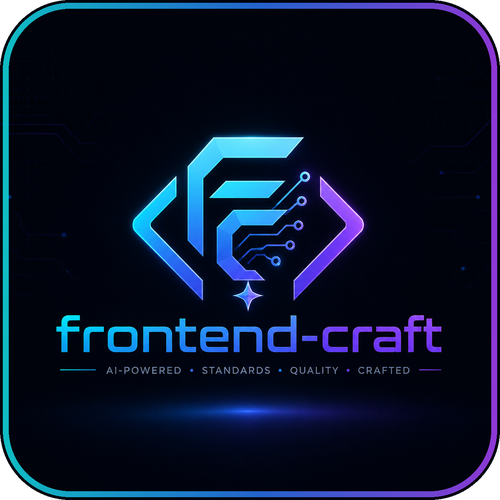

<div align="center">



# frontend-craft

### 将前端工程规范与工作流接入你的 AI 编程助手。

[](https://github.com/bovinphang/frontend-craft/stargazers)
[](https://github.com/bovinphang/frontend-craft/actions/workflows/ci.yml)
[](https://www.npmjs.com/package/@bovinphang/frontend-craft)
[](LICENSE)


**🌐 Language / 语言 / 語言 / 言語 / 언어**

[English](README.md) · [**简体中文**](README.zh-CN.md) · [繁體中文](docs/zh-TW/README.md) · [日本語](docs/ja-JP/README.md) · [한국어](docs/ko-KR/README.md)

</div>

Frontend Craft 将前端规范、设计实现、代码评审和测试工作流接入 **15 款 AI 编程助手**。

`claude` `codex` `cursor` `windsurf` `opencode`
`kilo` `gemini` `copilot` `antigravity` `augment`
`trae` `codebuddy` `cline` `openclaw` `qoder`

完整产品提供 **74 个 Skill**（53 个前端 Skill 和 21 个公共工程 Skill）、**14 个 Agent**、**11 个命令工作流**、**5 类 Claude Hook 事件**及 **6 个设计工具端点的 MCP 配置**，覆盖 React、Vue、Next.js 和 Nuxt。README 提供五种语言，安装资源支持英文和简体中文。

各运行时安装其支持的能力子集。使用 `fec matrix` 查看能力矩阵，资源路径与启用步骤见 [Runtime 指南](docs/runtimes/)。

## 核心能力

- 通过专项 Skill 应用架构、组件、状态、API 和测试规范。
- 在支持 Agent 的宿主中开展代码、安全、无障碍、性能、TypeScript 和 UI 评审。
- 通过已配置的 MCP 服务读取设计上下文，复用现有组件和设计 Token。
- 在 Claude、Qoder 中使用适配的 Hook，OpenClaw 原生包提供独立 typed hooks。
- 使用 `fec project inspect . --json` 只读识别工程并获取任务相关能力建议。

Skill 提供工程规范与方法，Agent 执行专项任务，命令工作流提供宿主支持的调用入口。终端中的 `fec setup` 接入资源，Claude Code 中的 `/fec-init` 准备项目指导配置。

## 快速开始

准备 **Node.js 22+**、已安装的 AI 编程助手和一个已有前端项目。CLI 支持 Windows、macOS 和 Linux。

### 1. 安装并接入助手

```sh
npm install -g @bovinphang/frontend-craft@latest
cd your-frontend-project
fec setup
```

将 `your-frontend-project` 替换为实际项目目录。在交互终端中，`fec setup` 会先让你选择一个或多个运行时，再选择英文或简体中文资源。方向键移动，空格勾选或取消，回车确认。初始勾选 Claude，只接入其他助手时先取消该选项。资源默认安装到**当前项目**。

需要跳过交互或编写脚本时，显式指定运行时、范围和语言。以下以 Codex 为例。

```sh
fec setup codex --local --lang zh-CN
```

### 2. 检查安装结果

```sh
fec doctor codex --local
```

在同一项目目录执行检查，将 `codex` 替换为实际选择的运行时标识，多选时逐个检查。`ok` 表示预期资源已找到，`missing` 表示需要排查的缺失资源，`not expected` 表示该适配器的能力范围无需此资源。缺失项的处理见 [Runtime 指南](docs/runtimes/)。

### 3. 完成首次任务

刷新或重启助手，打开项目并新建会话，确认助手发现了资源，并完成宿主要求的信任或启用操作。对于支持 Skill 的助手，将 `src/features/account` 替换为实际存在的模块路径后发送以下请求。

```text
使用 fec-code-review 对 src/features/account 中的全部代码做只读评审，不修改文件。
遵循仓库约定，检查类型、渲染、状态、无障碍和测试覆盖。
列出问题位置、影响及修复建议，没有发现问题时明确说明。
```

预期得到包含问题位置与修复建议的评审结果，或明确的无问题结论。Claude Code 也提供 `/fec-review`，各宿主的资源形式以 Runtime 指南为准。更多任务见[示例提示词](docs/zh-CN/example-prompts.md)。

## 其他安装方式

### 临时 npx 运行

通过 npx 使用同一接入向导。后续 CLI 命令同样添加 `npx @bovinphang/frontend-craft@latest` 前缀。

```sh
cd your-frontend-project
npx @bovinphang/frontend-craft@latest setup
```

### Claude Code Marketplace

使用 Claude Code 原生插件时，在助手内执行以下命令，并为 Claude 选择一个激活渠道。启用、渠道切换和项目初始化见 [Claude 指南](docs/runtimes/claude.zh-CN.md)。

```text
/plugin marketplace add bovinphang/frontend-craft
/plugin install frontend-craft@frontend-craft
/reload-plugins
```

### 用户级全局接入

需要跨项目使用时选择 `--global`。以下 Codex 示例显式指定全部选项。批量接入与默认值见 [CLI 管理](docs/cli-management.zh-CN.md)。

```sh
fec setup codex --global --lang zh-CN
```

### 独立 Skill 包

源码 `skills/` 目录维护 53 个前端 Skill，构建时组合另外 21 个公共 Skill。`pnpm run pack:skills` 从完整产物生成独立技能包，打包流程见[贡献指南](CONTRIBUTING.zh-CN.md)。使用 Skills CLI 的团队可按其文档发现仓库中的前端 Skill。[Skills CLI 文档](https://skills.sh/docs/cli)

## 能力目录

### 命令（Commands）

下表命令名称采用 Claude Code 语法。其他宿主使用适配器支持的命令或工作流形式，报告按对应工作流约定写入 `reports/`。

| 命令                  | 用途                                                        | 报告                                             |
| --------------------- | ----------------------------------------------------------- | ------------------------------------------------ |
| `/fec-init`           | 初始化项目模板（CLAUDE.md、规则、settings）                 | —                                                |
| `/fec-review`         | 默认审核全项目；支持指定文件、目录或明确改动范围 | `code-review-*.md`                               |
| `/fec-scaffold`       | 按规范创建 page / feature / component 样板                  | —                                                |
| `/fec-plan`           | 统一规划入口：实现架构或测试策略                            | `architecture-proposal-*.md` 或 `test-plan-*.md` |
| `/fec-tdd`            | 红 → 绿 → 重构的前端 TDD 循环                               | —                                                |
| `/fec-debug`          | 前端问题诊断与修复：构建失败、运行时错误、UI 异常、接口问题 | `debug-*.md`                                     |
| `/fec-refactor-clean` | 分类并安全清理死代码、未使用导出、样式和依赖                | `refactor-clean-*.md`                            |
| `/fec-smell`          | 基于证据诊断代码坏味道，不修改业务代码                            | `refactoring/smell-*.md`                       |
| `/fec-refactor-plan`  | 生成有序、保持行为的小步重构计划                                  | `refactoring/plan-*.md`                        |
| `/fec-refactor`       | 一次执行一个经过验证的保持行为重构步骤                            | `refactoring/refactoring-*.md`                 |
| `/fec-doc-sync`       | 同步 README、docs、环境变量、脚本、API/路由说明和部署文档 | —                                                |

评审支持全项目、指定文件或目录，以及显式改动范围。裸调用 `/fec-review` 默认全项目，首次任务建议明确目标范围。完整规则见[审核范围与图表工作流](docs/zh-CN/review-and-diagram-workflows.md)。

### 技能（Skills）

完整产品包含 74 个 Skill。源码仓库维护 53 个前端 Skill，构建时从 craft-common 组合 21 个公共 Skill。技能发现与激活取决于助手和任务上下文。

**按任务使用**的工作流定义，编码了评审维度、输出约定和报告格式。

下方按使用场景列出常用技能，便于快速找到项目规范、实现、测试、评审、设计、迁移、项目演进和文档维护能力。

**项目规范** — 检测到对应框架时按任务使用：

| 技能                            | 范围                                                  |
| ------------------------------- | ----------------------------------------------------- |
| `fec-react-project-standard`    | React + TypeScript（结构、组件、路由、状态、API 层）  |
| `fec-vue3-project-standard`     | Vue 3 + TypeScript（结构、组件、路由、Pinia、API 层） |
| `fec-nextjs-project-standard`   | Next.js 14+ App Router、SSR/SSG、流式渲染、元数据     |
| `fec-nuxt-project-standard`     | Nuxt 3 SSR/SSG、组合式 API、数据获取、中间件          |
| `fec-vite-project-standard`     | Vite 配置、环境变量安全、HMR、开发代理、构建优化      |
| `fec-monorepo-project-standard` | pnpm workspace、Turborepo、Nx 结构与任务编排          |
| `cc-typescript-project-standard`   | TypeScript 配置、公开类型、声明文件、DTO 和泛型       |

**实现能力** — 构建特定前端能力时激活：

| 技能                      | 范围                                                       |
| ------------------------- | ---------------------------------------------------------- |
| `fec-data-fetching`       | 服务端状态获取、缓存、失效、SSR、无限加载                  |
| `fec-api-integration`     | 类型化 API client、鉴权刷新、上传、实时集成                |
| `fec-state-management`    | 状态归属、store 选型、URL 状态、服务端/表单/本地状态边界   |
| `fec-form-handling`       | 跨框架表单选型、schema 校验、动态字段、上传                 |
| `fec-browser-storage`     | localStorage / sessionStorage / IndexedDB / Cookies 选型   |
| `fec-route-protection`    | React Router、Next.js、Vue Router、Nuxt 的登录态与权限路由 |
| `fec-pwa-implementation`  | manifest、Service Worker、离线缓存、安装提示               |
| `fec-web-workers`         | Web Worker、Transferable、Comlink、Worker 池               |
| `fec-canvas-threejs`      | Canvas 2D、Three.js、React Three Fiber、WebGL              |
| `fec-svg-animation`       | CSS / Framer Motion / GSAP SVG 动画与 reduced-motion       |
| `fec-list-virtualization` | 按框架选型的大列表虚拟滚动、测量、网格和无限滚动            |

**测试** — 规划或编写前端测试覆盖时激活：

| 技能                    | 范围                                                      |
| ----------------------- | --------------------------------------------------------- |
| `fec-testing-strategy`  | 静态检查、单元、组件、集成、E2E、视觉测试分层             |
| `fec-component-testing` | React Testing Library / Vue Test Utils 组件测试与回归用例 |
| `fec-e2e-testing`       | Playwright / Cypress E2E 与 Page Object 和 CI 集成        |
| `fec-tdd-workflow`      | 测试先行的前端实现，红绿重构循环                          |

**评审与质量** — 代码评审、验证或清理时激活：

| 技能                           | 范围                                                  |
| ------------------------------ | ----------------------------------------------------- |
| `fec-code-review`              | 架构、类型、渲染、样式、可访问性评审                  |
| `fec-debug-framework`          | 系统化诊断构建、运行时、UI 和 API/数据问题            |
| `fec-security-review`          | XSS、CSRF、敏感数据泄露、输入校验                     |
| `fec-accessibility-check`      | WCAG 2.2、键盘、焦点、触控和屏幕阅读器行为            |
| `fec-dependency-upgrade`       | 依赖升级、lockfile 评审、CVE 修复和迁移验证           |
| `fec-validation-fix`           | 一次性运行并修复 lint、type-check、test、build        |
| `fec-performance-optimization` | Core Web Vitals、包体、渲染、内存、网络与性能预算审查 |
| `fec-refactor-clean`           | 安全清理死代码、未使用导出、样式、路由和依赖          |

**重构** — 在基于证据、保持既有行为的结构改进任务中激活：

| Skill | 用途 |
| --- | --- |
| `fec-refactoring` | 编排请求分类、基线、安全网、小步执行、回滚和最终证明 |
| `fec-code-smells` | 基于证据诊断 24 种标准代码坏味道并检查误判 |
| `fec-refactoring-catalog` | 从完整 61 项目录中选择并组合合适手法 |
| `fec-refactoring-functions` | 函数拆分、命名、变量、参数对象和阶段拆分 |
| `fec-refactoring-encapsulation` | 记录、集合、基本类型、类、委托和算法封装 |
| `fec-refactoring-move-features` | 搬移函数/字段/语句、拆分循环、管道与死代码路由 |
| `fec-refactoring-data` | 变量/字段以及引用对象/值对象数据重构 |
| `fec-refactoring-control` | 条件拆分、卫语句、多态分派、特例和断言 |
| `fec-refactoring-api` | 查询/修改、参数、标记参数、工厂、命令和 API 形态重构 |
| `fec-refactoring-inheritance` | 继承/委托重构及组合优先的前端适配 |
| `fec-refactoring-validation` | 行为契约、覆盖等级、验证阶梯与证明结论 |

**设计 UI** — 设计实现、设计系统或视觉打磨时激活：

| 技能                          | 范围                                                     |
| ----------------------------- | -------------------------------------------------------- |
| `fec-ui-design`               | 产品语境 UI 方向、反模板设计拨盘、媒体策略、状态、视觉 QA |
| `fec-image-generation`        | UI、产品和品牌视觉生成与编辑，复用公共 PNG 质检 |
| `cc-drawio-studio`         | 可编辑 draw.io / diagrams.net 技术图、XML/Mermaid/CSV URL 交付、形状检索、自动布局和代码结构图 |
| `fec-web-video-presentation` | 将文章、口播稿、课程和 demo 转成可录屏的 16:9 步进网页演示 |
| `fec-tailwind-design-system`  | Tailwind token、主题扩展、组件变体、class 治理和暗色模式 |
| `fec-responsive-layout`       | 移动优先布局、容器查询、数据密集型响应式界面             |
| `fec-motion-interaction`      | 场景化动效强度、页面转场、滚动动画、reduced-motion       |
| `fec-implement-from-design`   | 基于设计工具、截图或分区级视觉参考实现 UI                |
| `fec-storybook-component-doc` | Storybook 组件文档、设计系统呈现、隔离状态预览           |


[审核范围与技术图交付指南](docs/zh-CN/review-and-diagram-workflows.md).

**遗留迁移** — 现代化迁移时激活：

| 技能                             | 范围                                           |
| -------------------------------- | ---------------------------------------------- |
| `fec-legacy-web-standard`        | JS + jQuery + HTML 遗留项目的开发与维护规范    |
| `fec-legacy-to-modern-migration` | 遗留前端现代化、目标栈识别与分阶段迁移流程 |

**项目演进** — 吸收参考系统并原创化落到当前项目时激活：

| 技能          | 范围                                       |
| ------------- | ------------------------------------------ |
| `fec-alchemy` | 将参考系统能力原创化吸收到当前项目原生体系 |

**文档维护** — 文档维护时激活：

| 技能                            | 范围                                       |
| ------------------------------- | ------------------------------------------ |
| `fec-backend-requirements-handoff` | 前端向后端交接 UI 数据需求、用户动作、状态、业务规则与待确认问题 |
| `fec-doc-sync`                  | 让前端文档与代码、配置、脚本、路由、API、环境变量和部署事实保持同步 |
| `cc-source-driven-development` | 以项目事实和官方来源验证版本敏感的前端决策 |

### 代理（Agents）

Claude、Codex 和 Qoder 支持安装 Agent，下表列出可用的专项角色。

| 代理                        | 聚焦领域                                                  | 报告                         |
| --------------------------- | --------------------------------------------------------- | ---------------------------- |
| `fec-code-reviewer`         | React/Vue/Next/Nuxt、TS、样式、客户端安全（按置信度降噪） | `code-review-*.md`           |
| `fec-typescript-reviewer`   | 类型安全、异步正确性、惯用模式（只报告不修改）            | `typescript-review-*.md`     |
| `fec-security-reviewer`     | XSS、客户端密钥、危险 DOM/API、CSP、依赖审计              | `security-review-*.md`       |
| `fec-performance-optimizer` | 打包体积、渲染性能、网络瓶颈                              | `performance-review-*.md`    |
| `fec-architect`             | 页面拆分、组件架构、状态流、目录规划                      | `architecture-proposal-*.md` |
| `fec-test-planner`          | 风险-层级映射：静态、单元、组件、E2E、视觉、无障碍、安全  | `test-plan-*.md`             |
| `fec-debugger`              | 复杂前端诊断：构建、运行时、UI 和接口问题                 | `debug-*.md`                 |
| `fec-refactor-cleaner`      | 分类并安全清理未使用代码、导出、样式、路由和依赖          | `refactor-clean-*.md`        |
| `fec-refactoring-expert`   | 基于证据编排保持行为的结构重构                              | `refactoring/refactoring-*.md` |
| `fec-e2e-runner`            | E2E 编写与运行（Playwright/Cypress）、flaky 隔离、Trace   | `e2e-summary-*.md`           |
| `fec-doc-updater`           | 同步 README、runtime 文档、结构、能力表和 metadata        | —                            |
| `fec-ui-checker`            | 视觉问题排查与设计还原度评估                              | `ui-fidelity-review-*.md`    |
| `fec-figma-implementer`     | 按 Figma/Sketch/MasterGo/Pixso/墨刀设计稿精确实现 UI      | `design-implementation-*.md` |
| `fec-design-token-mapper`   | 将设计变量映射到项目 Design Token                         | `token-mapping-*.md`         |

### Hook、设计工具与项目模板

Claude 和 Qoder 适配器安装受支持的 Hook，Codex 安装 Skill、Agent、规则和模板。MCP 配置及凭据按宿主接入，OpenClaw 原生包有独立 typed hooks。具体步骤见[配置与报告指南](docs/zh-CN/configuration.md)及 [Runtime 指南](docs/runtimes/)。

## 配置与报告

根据所用宿主配置设计工具 MCP 和 Hook。[配置指南](docs/zh-CN/configuration.md)介绍令牌变量、Hook 行为与报告文件名。工作流按约定在 `reports/` 写入带时间戳的 Markdown 报告，是否提交报告由团队决定。

## 更新与卸载

`fec update` 升级经过来源验证的 npm/pnpm 全局 CLI，并刷新当前项目与用户全局的托管资源。`fec runtime update` 使用当前包刷新资源，默认保留各安装的语言。资源更新保护用户修改。

```sh
fec update --dry-run
fec update
fec runtime update codex --local
fec runtime uninstall codex --local --dry-run
fec runtime uninstall codex --local
fec uninstall --yes
```

`fec runtime uninstall` 移除清单管理的资源，默认保留用户修改。`fec uninstall --yes` 卸载全局 CLI，添加 `--purge` 可先清理发现的托管资源。来源要求、预览和失败恢复见 [CLI 管理](docs/cli-management.zh-CN.md)，公共资源冲突见[迁移指南](docs/zh-CN/common-migration.md)。

## 文档导航

- [Runtime 指南](docs/runtimes/)
- [CLI 管理](docs/cli-management.zh-CN.md)
- [示例提示词](docs/zh-CN/example-prompts.md)
- [配置与报告](docs/zh-CN/configuration.md)
- [审核范围与图表](docs/zh-CN/review-and-diagram-workflows.md)
- [重构指南](docs/refactoring/README.md)
- [公共资源迁移](docs/zh-CN/common-migration.md)
- [完整文档索引](docs/README.zh-CN.md)

## 源码开发与贡献

本仓库维护前端 Skill、Agent 和工作流，公共 `cc-*` Skill 与工程方法在 [craft-common](https://github.com/bovinphang/craft-common) 统一维护。`pnpm build` 在 `dist/package/` 生成完整英文和简体中文产品。使用 Node.js 22+ 和 `package.json` 声明的 pnpm 版本，依赖以 `package.json` 和 `pnpm-lock.yaml` 为准。

```sh
git clone https://github.com/bovinphang/frontend-craft.git
cd frontend-craft
pnpm install --frozen-lockfile
pnpm build
node dist/package/dist/bin/frontend-craft.js list --json
```

在仓库根目录执行以下命令，加载组合后的 Claude 插件。

```sh
claude --plugin-dir ./dist/package
```

开发检查、多语言维护及发行归档（`pnpm run pack:all`）见[贡献指南](CONTRIBUTING.zh-CN.md)。

## 社区

- [贡献指南](CONTRIBUTING.zh-CN.md) — 开发环境、PR 自检清单与多语言同步规则（[English](CONTRIBUTING.md)）
- [安全策略](SECURITY.zh-CN.md) — 私密漏洞报告方式与支持范围（[English](SECURITY.md)）
- [行为准则](CODE_OF_CONDUCT.zh-CN.md) — 社区参与规范（[English](CODE_OF_CONDUCT.md)）
- [变更日志](CHANGELOG.zh-CN.md) — 版本说明（[English](CHANGELOG.md)）
- [项目结构](docs/zh-CN/project-structure.md) — 完整目录布局与文件职责（[English](docs/project-structure.md)）

**如果 frontend-craft 帮助了你的团队，[请给它一个 Star](https://github.com/bovinphang/frontend-craft)。**

## 许可证

[MIT](LICENSE) © bovinphang。
