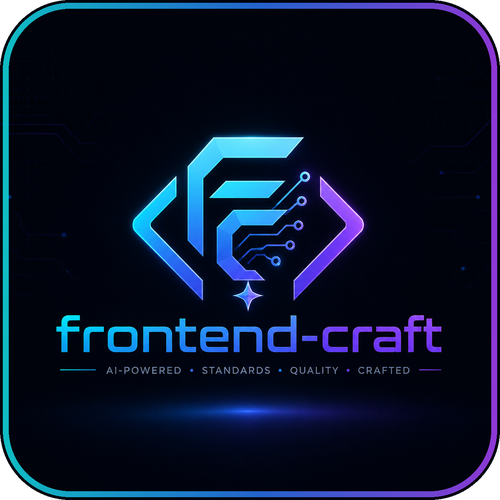

<div align="center">



# frontend-craft

### AI コーディングアシスタントにフロントエンドの規約とワークフローを。

[](https://github.com/bovinphang/frontend-craft/stargazers)
[](https://github.com/bovinphang/frontend-craft/actions/workflows/ci.yml)
[](https://www.npmjs.com/package/@bovinphang/frontend-craft)
[](../../LICENSE)


**🌐 Language / 语言 / 語言 / 言語 / 언어**

[English](../../README.md) · [简体中文](../../README.zh-CN.md) · [繁體中文](../zh-TW/README.md) · [**日本語**](README.md) · [한국어](../ko-KR/README.md)

</div>

Frontend Craft はフロントエンドの規約、デザイン実装、レビュー、テストのワークフローを **15 の AI コーディングアシスタント**に提供します。

`claude` `codex` `cursor` `windsurf` `opencode`
`kilo` `gemini` `copilot` `antigravity` `augment`
`trae` `codebuddy` `cline` `openclaw` `qoder`

製品全体には **74 のスキル**（フロントエンド 53、共通 21）、**14 のエージェント**、**11 のコマンドワークフロー**、**5 種の Claude フックイベント**、**6 つのデザインツール接続先の MCP 設定**が含まれます。React、Vue、Next.js、Nuxt を対象とします。README は 5 言語、インストールするリソースは英語と簡体字中国語に対応します。

ランタイムごとに対応する機能をインストールします。`fec matrix` で対応表を確認し、パスと有効化手順は[ランタイムガイド](../../docs/runtimes/)を参照してください。

## 主な機能

- スキルで設計、コンポーネント、状態、API、テストの規約を適用します。
- 対応ホストのエージェントでコード、安全性、アクセシビリティ、性能、TypeScript、UI をレビューします。
- 設定済み MCP サービスからデザイン情報を読み取り、既存のコンポーネントとトークンを再利用します。
- Claude と Qoder は対応フックを使用し、OpenClaw ネイティブパッケージは独自の typed hooks を提供します。
- `fec project inspect . --json` でプロジェクトを読み取り専用で調査し、適切なスキルを確認します。

スキルは規約と手法、エージェントは専門タスク、コマンドワークフローはホスト別の呼び出し入口を提供します。ターミナルの `fec setup` で接続し、Claude Code の `/fec-init` でプロジェクト設定を準備します。

## クイックスタート

**Node.js 22+**、インストール済みの AI アシスタント、既存のフロントエンドプロジェクトを用意してください。CLI は Windows、macOS、Linux に対応します。

### 1. インストールと接続

```sh
npm install -g @bovinphang/frontend-craft@latest
cd your-frontend-project
fec setup
```

`your-frontend-project` を実際のディレクトリに置き換えます。対話式ターミナルの `fec setup` でランタイムを 1 つ以上選び、英語または簡体字中国語のリソースを選びます。矢印キーで移動、Space で選択・解除、Enter で確定します。最初は Claude が選択されています。他のアシスタントだけを使う場合は解除してください。既定では**現在のプロジェクト**にインストールします。

対話を省略する場合やスクリプトではランタイム、範囲、言語を指定します。Codex の例です。

```sh
fec setup codex --local --lang en
```

### 2. インストールの確認

```sh
fec doctor codex --local
```

同じプロジェクトで実行し、`codex` を選択した識別子に置き換えて各ランタイムを確認します。`ok` は想定するリソースの存在、`missing` は要調査の不足、`not expected` は対応機能の範囲に含まれない項目を示します。[ランタイムガイド](../../docs/runtimes/)を参照してください。

### 3. 最初のタスク

アシスタントを更新または再起動し、プロジェクトで新しい会話を開始します。リソースの検出を確認し、ホストの信頼・有効化手順を完了してください。スキル対応のアシスタントで `src/features/account` を実在するモジュールに置き換え、次を依頼します。

```text
fec-code-review で src/features/account の全コードを読み取り専用でレビューしてください。
規約に従い、型、描画、状態、アクセシビリティ、テストを確認してください。
問題の場所、影響、修正案を示し、問題がなければ明記してください。
```

問題の場所と修正案、または問題なしという結果を確認します。Claude Code は `/fec-review` も提供します。ホスト別の形式はランタイムガイド、その他のタスクは[プロンプト例](../../docs/example-prompts.md)を参照してください。

## その他のインストール方法

### npx による一時実行

npx から同じ設定ウィザードを実行できます。以降の CLI コマンドにも `npx @bovinphang/frontend-craft@latest` を付けます。

```sh
cd your-frontend-project
npx @bovinphang/frontend-craft@latest setup
```

### Claude Code Marketplace

Claude Code のネイティブプラグインはアシスタント内で次を実行します。Claude の有効なインストール経路を 1 つ選びます。有効化、切り替え、初期設定は [Claude ガイド](../../docs/runtimes/claude.md)を参照してください。

```text
/plugin marketplace add bovinphang/frontend-craft
/plugin install frontend-craft@frontend-craft
/reload-plugins
```

### ユーザー全体へのインストール

プロジェクト間で共用する場合は `--global` を使います。Codex の例はすべての選択肢を指定しています。一括操作と既定値は [CLI 管理](../../docs/cli-management.md)を参照してください。

```sh
fec setup codex --global --lang en
```

### 独立スキルパッケージ

ソースの `skills/` は 53 のフロントエンドスキルを管理し、ビルド時に共通スキル 21 個を組み合わせます。`pnpm run pack:skills` は製品全体から独立パッケージを生成します。手順は[貢献ガイド](../../CONTRIBUTING.md)を参照してください。Skills CLI でリポジトリのスキルを利用する場合は公式ガイドを参照してください。[Skills CLI](https://skills.sh/docs/cli)

## 機能一覧

### コマンド

以下のコマンド名は Claude Code の構文です。他のホストはアダプター対応の形式を使います。レポートは各ワークフローの規約に従って `reports/` に保存します。

| コマンド              | 用途                                                                   | レポート                                             |
| --------------------- | ---------------------------------------------------------------------- | ---------------------------------------------------- |
| `/fec-init`           | プロジェクトテンプレート（CLAUDE.md、ルール、設定）を初期化            | —                                                    |
| `/fec-review`         | 既定はプロジェクト全体。ファイル・ディレクトリや変更範囲の明示も可能 | `code-review-*.md`                                   |
| `/fec-scaffold`       | 規約に従い page / feature / component のボイラープレートを作成         | —                                                    |
| `/fec-plan`           | 統合計画：実装アーキテクチャまたはテスト戦略                           | `architecture-proposal-*.md` または `test-plan-*.md` |
| `/fec-tdd`            | 赤 → 緑 → リファクタリングのフロントエンド TDD ループ                  | —                                                    |
| `/fec-debug`          | フロントエンド問題の診断と修復：ビルド、ランタイム、UI、API 障害       | `debug-*.md`                                         |
| `/fec-refactor-clean` | デッドコード、未使用 export、スタイル、依存関係を分類して安全に削除    | `refactor-clean-*.md`                                |
| `/fec-smell` | Diagnose code smells without editing | `refactoring/smell-*.md` |
| `/fec-refactor-plan` | Plan behavior-preserving refactoring | `refactoring/plan-*.md` |
| `/fec-refactor` | Execute validated behavior-preserving refactoring | `refactoring/refactoring-*.md` |
| `/fec-doc-sync`       | README、docs、環境変数、スクリプト、API/ルート説明、デプロイ文書を同期 | —                                                    |

全プロジェクト、指定ファイル・ディレクトリ、明示的な差分のレビューに対応します。単独の `/fec-review` は全プロジェクトが対象です。最初のタスクでは範囲を指定してください。詳細は[レビューと図表のガイド](../../docs/review-and-diagram-workflows.md)を参照してください。

### スキル

製品全体は 74 のスキルを含みます。ソースは 53 のフロントエンドスキルを管理し、ビルド時に craft-common の 21 の共通スキルを組み合わせます。検出と起動はアシスタントとタスクに依存します。


以下のスキルはユースケース別に分類されているため、プロジェクト標準、実装、テスト、レビュー、デザイン、移行、プロジェクト進化、ドキュメント保守のワークフローをすばやく見つけられます。

**プロジェクト標準** — プロジェクトのフレームワークに応じて使用：

| スキル                            | 範囲                                                                    |
| --------------------------------- | ----------------------------------------------------------------------- |
| `fec-react-project-standard`      | React + TypeScript（構造、コンポーネント、ルーティング、状態、API 層）  |
| `fec-vue3-project-standard`       | Vue 3 + TypeScript（構造、コンポーネント、ルーティング、Pinia、API 層） |
| `fec-nextjs-project-standard`     | Next.js 14+ App Router、SSR/SSG、ストリーミング、メタデータ             |
| `fec-nuxt-project-standard`       | Nuxt 3 SSR/SSG、Composition API、データ取得、ミドルウェア               |
| `fec-vite-project-standard`       | Vite 設定、環境変数安全性、HMR、開発プロキシ、ビルド最適化              |
| `fec-monorepo-project-standard`   | pnpm workspace、Turborepo、Nx の構造とタスクオーケストレーション        |
| `cc-typescript-project-standard` | TypeScript 設定、公開 API 型、宣言ファイル、DTO、ジェネリクス           |

**実装機能** — 特定のフロントエンド機能を構築する際に起動：

| スキル                    | 範囲                                                                                    |
| ------------------------- | --------------------------------------------------------------------------------------- |
| `fec-data-fetching`       | サーバー状態取得、キャッシュ、無効化、SSR、無限読み込み                                 |
| `fec-api-integration`     | 型付き API client、認証 refresh、アップロード、リアルタイム統合                         |
| `fec-state-management`    | 状態の所属、ストア選定、URL 状態、サーバー/フォーム/ローカル状態の境界                  |
| `fec-form-handling`       | フレームワークに応じたフォーム選定、schema バリデーション、動的フィールド、アップロード |
| `fec-browser-storage`     | localStorage / sessionStorage / IndexedDB / Cookies の選定                              |
| `fec-route-protection`    | React Router、Next.js、Vue Router、Nuxt の認証・権限ルーティング                        |
| `fec-pwa-implementation`  | マニフェスト、サービスワーカー、オフラインキャッシュ、インストールプロンプト            |
| `fec-web-workers`         | Web Worker、Transferable、Comlink、ワーカープール                                       |
| `fec-canvas-threejs`      | Canvas 2D、Three.js、React Three Fiber、WebGL                                           |
| `fec-svg-animation`       | CSS / Framer Motion / GSAP SVG アニメーションと reduced-motion                          |
| `fec-list-virtualization` | フレームワークに応じた大規模リスト仮想化、計測、グリッド、無限スクロール                |

**テスト** — フロントエンドテストの計画や作成時に起動：

| スキル                  | 範囲                                                            |
| ----------------------- | --------------------------------------------------------------- |
| `fec-testing-strategy`  | 静的、ユニット、コンポーネント、統合、E2E、視覚テストの階層選択 |
| `fec-component-testing` | React Testing Library / Vue Test Utils とリグレッションシナリオ |
| `fec-e2e-testing`       | Playwright / Cypress E2E と Page Object、CI 統合                |
| `fec-tdd-workflow`      | テストファーストのフロントエンド実装、赤緑リファクタリング      |

**レビューと品質** — レビュー、検証、クリーンアップ時に起動：

| スキル                         | 範囲                                                                          |
| ------------------------------ | ----------------------------------------------------------------------------- |
| `fec-code-review`              | アーキテクチャ、型、レンダリング、スタイル、a11y レビュー                     |
| `fec-debug-framework`          | ビルド、ランタイム、UI、API/データ障害の体系的な診断                          |
| `fec-security-review`          | XSS、CSRF、機密データ漏洩、入力検証                                           |
| `fec-accessibility-check`      | WCAG 2.2、キーボード、フォーカス、タッチ、スクリーンリーダー動作              |
| `fec-dependency-upgrade`       | 依存関係アップグレード、lockfile レビュー、CVE 修正、移行検証                 |
| `fec-validation-fix`           | lint、type-check、test、build を一度に実行して修復                            |
| `fec-performance-optimization` | Core Web Vitals、バンドル、レンダリング、メモリ、ネットワーク、予算レビュー   |
| `fec-refactor-clean`           | デッドコード、未使用 export、スタイル、ルート、依存関係の安全なクリーンアップ |

**Refactoring**

| Skill | Scope |
| --- | --- |
| `fec-refactoring` | Behavior-preserving refactoring capability |
| `fec-code-smells` | Behavior-preserving refactoring capability |
| `fec-refactoring-catalog` | Behavior-preserving refactoring capability |
| `fec-refactoring-functions` | Behavior-preserving refactoring capability |
| `fec-refactoring-encapsulation` | Behavior-preserving refactoring capability |
| `fec-refactoring-move-features` | Behavior-preserving refactoring capability |
| `fec-refactoring-data` | Behavior-preserving refactoring capability |
| `fec-refactoring-control` | Behavior-preserving refactoring capability |
| `fec-refactoring-api` | Behavior-preserving refactoring capability |
| `fec-refactoring-inheritance` | Behavior-preserving refactoring capability |
| `fec-refactoring-validation` | Behavior-preserving refactoring capability |

**デザイン UI** — デザイン実装、デザインシステム、視覚仕上げで起動：

| スキル                        | 範囲                                                                                                             |
| ----------------------------- | ---------------------------------------------------------------------------------------------------------------- |
| `fec-ui-design`               | プロダクト文脈に沿った UI 方向性、反テンプレート設計ダイヤル、メディア戦略、状態、ビジュアル QA                  |
| `fec-image-generation`        | UI・製品・ブランド画像の生成と編集、共通 PNG 品質チェック |
| `cc-drawio-studio`           | 編集可能な draw.io / diagrams.net 技術図、XML/Mermaid/CSV URL 受け渡し、shape 検索、自動レイアウト、コード構造図 |
| `fec-web-video-presentation`  | 記事、台本、レッスン、demo から録画可能な 16:9 step-driven Web プレゼンを作成                                    |
| `fec-tailwind-design-system`  | Tailwind token、テーマ拡張、variants、class 管理、ダークモード                                                   |
| `fec-responsive-layout`       | モバイルファースト、container queries、データ密集 responsive UI                                                  |
| `fec-motion-interaction`      | 文脈に応じた motion 強度、ページ遷移、スクロール animation、reduced-motion                                       |
| `fec-implement-from-design`   | デザインツール、スクリーンショット、または section 単位のビジュアル参照から UI を実装                            |
| `fec-storybook-component-doc` | Storybook コンポーネント文書、デザインシステム表示、隔離状態プレビュー                                           |

技術図の品質: 標準のシーケンス図とフローチャートはローカル Mermaid、編集可能な構成図は draw.io を優先します。ツールがない場合は JSON/HTML を使用します。PNG と同じ倍率の実測 manifest で QA を実行し、最終画像を目視確認します。修正は原則 2 回までで、未解決の問題を報告します。

[レビューと技術図のガイド](../review-and-diagram-workflows.md).

**レガシー移行** — モダナイゼーション時に起動：

| スキル                           | 範囲                                                                           |
| -------------------------------- | ------------------------------------------------------------------------------ |
| `fec-legacy-web-standard`        | JS + jQuery + HTML のレガシープロジェクト開発・保守基準                        |
| `fec-legacy-to-modern-migration` | レガシーフロントエンドのモダナイズ、ターゲットスタック選定、段階的ワークフロー |

**プロジェクト進化** — 参照システムをプロジェクトネイティブな改善として吸収する時に起動：

| スキル        | 範囲                                                           |
| ------------- | -------------------------------------------------------------- |
| `fec-alchemy` | 参照システムの能力を独自のプロジェクトネイティブ設計として吸収 |

**ドキュメント保守** — ドキュメント作業時に起動：

| スキル                             | 範囲                                                                                    |
| ---------------------------------- | --------------------------------------------------------------------------------------- |
| `fec-backend-requirements-handoff` | Frontend-to-backend handoff for UI data needs, actions, states, rules, and questions    |
| `fec-doc-sync`                     | フロントエンド文書をコード、設定、スクリプト、ルート、API、環境変数、デプロイ事実と同期 |
| `cc-source-driven-development`    | プロジェクト事実と公式ソースでバージョン依存の判断を検証                                |

### エージェント

Claude、Codex、Qoder はエージェントのインストールに対応します。以下は専門ロールの一覧です。

| エージェント                | 焦点                                                                                 | レポート                     |
| --------------------------- | ------------------------------------------------------------------------------------ | ---------------------------- |
| `fec-code-reviewer`         | React/Vue/Next/Nuxt、TS、スタイル、クライアント側セキュリティ（信頼度ベース）        | `code-review-*.md`           |
| `fec-typescript-reviewer`   | 型安全性、非同期の正しさ、慣用的パターン（レポートのみ）                             | `typescript-review-*.md`     |
| `fec-security-reviewer`     | XSS、クライアントシークレット、危険な DOM/API、CSP、依存関係監査                     | `security-review-*.md`       |
| `fec-performance-optimizer` | バンドルサイズ、レンダリングパフォーマンス、ネットワークボトルネック                 | `performance-review-*.md`    |
| `fec-architect`             | ページ分割、コンポーネントアーキテクチャ、状態フロー、ディレクトリ計画               | `architecture-proposal-*.md` |
| `fec-test-planner`          | リスク→階層マトリクス：静的、ユニット、コンポーネント、E2E、視覚、a11y、セキュリティ | `test-plan-*.md`             |
| `fec-debugger`              | ビルド、ランタイム、UI、API 障害の複雑なフロントエンド診断                           | `debug-*.md`                 |
| `fec-refactor-cleaner`      | 未使用コード、export、スタイル、ルート、依存関係の分類と安全な削除                   | `refactor-clean-*.md`        |
| `fec-refactoring-expert` | Behavior-preserving refactoring orchestration | `refactoring/refactoring-*.md` |
| `fec-e2e-runner`            | E2E 作成と実行（Playwright/Cypress）、flaky 隔離、トレース                           | `e2e-summary-*.md`           |
| `fec-doc-updater`           | README、ランタイムドキュメント、構造、機能表、メタデータの同期                       | —                            |
| `fec-ui-checker`            | 視覚的問題のデバッグとデザイン忠実度評価                                             | `ui-fidelity-review-*.md`    |
| `fec-figma-implementer`     | Figma/Sketch/MasterGo/Pixso/墨刀 デザインからの正確な UI 実装                        | `design-implementation-*.md` |
| `fec-design-token-mapper`   | デザイン変数をプロジェクトの Design Token にマッピング                               | `token-mapping-*.md`         |

### フック、デザインツール、テンプレート

Claude と Qoder は対応フックをインストールします。Codex はスキル、エージェント、ルール、テンプレートをインストールします。MCP はホスト別に設定し、OpenClaw ネイティブパッケージは独自の typed hooks を使います。[設定ガイド](../../docs/configuration.md)と[ランタイムガイド](../../docs/runtimes/)を参照してください。

## 設定とレポート

ホストに応じて MCP 接続とフックを設定します。[設定ガイド](../../docs/configuration.md)にトークン変数、フック動作、レポート名をまとめています。ワークフローは規約に従い `reports/` に日時付き Markdown を出力します。履歴管理の方針はチームで選択してください。

## 更新とアンインストール

`fec update` は出所を確認した npm/pnpm グローバル CLI を更新し、現在のプロジェクトとユーザー全体の管理対象リソースを更新します。`fec runtime update` は実行中パッケージを使い、各インストールの言語とユーザーの変更を保護します。

```sh
fec update --dry-run
fec update
fec runtime update codex --local
fec runtime uninstall codex --local --dry-run
fec runtime uninstall codex --local
fec uninstall --yes
```

`fec runtime uninstall` はマニフェスト管理のリソースを削除し、既定ではユーザーの変更を保持します。`fec uninstall --yes` はグローバル CLI を削除します。先に管理対象リソースを削除する場合は `--purge` を追加します。[CLI 管理](../../docs/cli-management.md)と[移行ガイド](../../docs/common-migration.md)を参照してください。

## ドキュメント

- [ランタイム](../../docs/runtimes/)
- [CLI 管理](../../docs/cli-management.md)
- [プロンプト例](../../docs/example-prompts.md)
- [設定とレポート](../../docs/configuration.md)
- [レビューと図表](../../docs/review-and-diagram-workflows.md)
- [リファクタリング](../../docs/refactoring/README.md)
- [共通リソースの移行](../../docs/common-migration.md)
- [全ドキュメント](../../docs/README.md)

## ソース開発と貢献

フロントエンドのスキル、エージェント、ワークフローをこのリポジトリで管理します。共通 `cc-*` スキルと手法は [craft-common](https://github.com/bovinphang/craft-common) で管理し、`pnpm build` で英語・簡体字中国語の製品を `dist/package/` に生成します。Node.js 22+ と `package.json` 指定の pnpm を使い、依存関係は `pnpm-lock.yaml` に従います。

```sh
git clone https://github.com/bovinphang/frontend-craft.git
cd frontend-craft
pnpm install --frozen-lockfile
pnpm build
node dist/package/dist/bin/frontend-craft.js list --json
```

リポジトリルートから生成した Claude プラグインを読み込みます。

```sh
claude --plugin-dir ./dist/package
```

開発チェック、翻訳、配布アーカイブ（`pnpm run pack:all`）は[貢献ガイド](../../CONTRIBUTING.md)を参照してください。

## コミュニティ

- [貢献ガイド](../../CONTRIBUTING.md) — 開発環境セットアップ、PR チェックリスト、ローカライゼーション方針（[简体中文](../../CONTRIBUTING.zh-CN.md)）
- [セキュリティポリシー](../../SECURITY.md) — プライベート脆弱性報告（[简体中文](../../SECURITY.zh-CN.md)）
- [行動規範](../../CODE_OF_CONDUCT.md) — コミュニティ基準（[简体中文](../../CODE_OF_CONDUCT.zh-CN.md)）
- [変更履歴](../../CHANGELOG.md) — リリースノート（[简体中文](../../CHANGELOG.zh-CN.md)）
- [プロジェクト構造](../project-structure.md) — 完全なディレクトリレイアウトとファイルの責務

**frontend-craft がチームの助けになったら、[Star をお願いします](https://github.com/bovinphang/frontend-craft)。**

## ライセンス

[MIT](../../LICENSE) © bovinphang.
