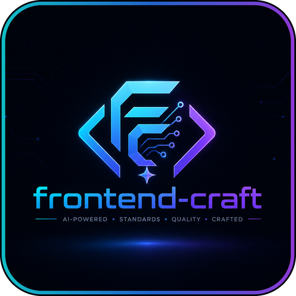

<div align="center">



# frontend-craft

### AI 코딩 도우미에 프론트엔드 규칙과 워크플로를 연결하세요.

[](https://github.com/bovinphang/frontend-craft/stargazers)
[](https://github.com/bovinphang/frontend-craft/actions/workflows/ci.yml)
[](https://www.npmjs.com/package/@bovinphang/frontend-craft)
[](../../LICENSE)


**🌐 Language / 语言 / 語言 / 言語 / 언어**

[English](../../README.md) · [简体中文](../../README.zh-CN.md) · [繁體中文](../zh-TW/README.md) · [日本語](../ja-JP/README.md) · [**한국어**](README.md)

</div>

Frontend Craft는 프론트엔드 규칙, 디자인 구현, 검토와 테스트 워크플로를 **15개 AI 코딩 도우미**에 제공합니다.

`claude` `codex` `cursor` `windsurf` `opencode`
`kilo` `gemini` `copilot` `antigravity` `augment`
`trae` `codebuddy` `cline` `openclaw` `qoder`

전체 제품에는 **스킬 74개**(프론트엔드 53개, 공통 21개), **에이전트 14개**, **명령 워크플로 11개**, **Claude 훅 이벤트 5종**, **디자인 도구 엔드포인트 6개의 MCP 설정**이 포함됩니다. React, Vue, Next.js, Nuxt를 다룹니다. README는 5개 언어이며 설치 리소스는 영어와 중국어 간체를 지원합니다.

런타임마다 지원하는 기능을 설치합니다. `fec matrix`로 기능을 확인하고 경로와 활성화 절차는 [런타임 가이드](../../docs/runtimes/)를 참조하세요.

## 핵심 기능

- 스킬로 아키텍처, 컴포넌트, 상태, API와 테스트 규칙을 적용합니다.
- 지원 호스트에서 전문 에이전트로 코드, 보안, 접근성, 성능, TypeScript와 UI를 검토합니다.
- 설정한 MCP 서비스로 디자인 맥락을 읽고 기존 컴포넌트와 토큰을 재사용합니다.
- Claude와 Qoder는 지원 훅을 사용하며 OpenClaw 네이티브 패키지는 별도의 typed hooks를 제공합니다.
- `fec project inspect . --json`으로 프로젝트를 읽기 전용으로 조사하고 적합한 스킬을 확인합니다.

스킬은 개발 규칙과 방법을 제공하고 에이전트는 전문 작업을 수행하며 명령 워크플로는 호스트별 호출 진입점을 제공합니다. 터미널의 `fec setup`으로 리소스를 연결하고 Claude Code의 `/fec-init`으로 프로젝트 설정을 준비합니다.

## 빠른 시작

**Node.js 22+**, 설치된 AI 코딩 도우미와 기존 프론트엔드 프로젝트를 준비하세요. CLI는 Windows, macOS, Linux를 지원합니다.

### 1. 설치 및 도우미 연결

```sh
npm install -g @bovinphang/frontend-craft@latest
cd your-frontend-project
fec setup
```

`your-frontend-project`를 실제 경로로 바꾸세요. 대화형 터미널의 `fec setup`에서 런타임을 하나 이상 선택한 다음 영어 또는 중국어 간체 리소스를 선택합니다. 방향키로 이동하고 Space로 선택·해제하며 Enter로 확정합니다. 처음에는 Claude가 선택되어 있으므로 다른 도우미만 사용하려면 해제하세요. 기본적으로 **현재 프로젝트**에 설치합니다.

대화형 선택을 생략하거나 스크립트에서 실행하려면 런타임, 범위와 언어를 지정하세요. 다음은 Codex 예시입니다.

```sh
fec setup codex --local --lang en
```

### 2. 설치 확인

```sh
fec doctor codex --local
```

같은 프로젝트에서 실행하고 `codex`를 실제 런타임 식별자로 바꿔 각각 확인하세요. `ok`는 예상 리소스가 있음을, `missing`은 조사할 누락 항목을, `not expected`는 어댑터 지원 범위에 해당하지 않는 항목을 뜻합니다. [런타임 가이드](../../docs/runtimes/)를 참조하세요.

### 3. 첫 작업 실행

도우미를 새로 고치거나 다시 시작하고 프로젝트에서 새 대화를 여세요. 리소스 검색을 확인하고 필요한 호스트 신뢰·활성화 절차를 완료하세요. 스킬 지원 도우미에서 `src/features/account`를 실제 모듈 경로로 바꾼 뒤 다음을 요청하세요.

```text
fec-code-review로 src/features/account의 전체 코드를 읽기 전용으로 검토하고 파일은 수정하지 마세요.
저장소 규칙에 따라 타입, 렌더링, 상태, 접근성과 테스트를 확인하세요.
문제 위치, 영향과 수정 제안을 제시하고 문제가 없으면 명시하세요.
```

문제 위치와 수정 제안 또는 문제가 없다는 결과를 확인하세요. Claude Code는 `/fec-review`도 제공합니다. 호스트별 리소스 형식은 런타임 가이드, 추가 작업은 [프롬프트 예시](../../docs/example-prompts.md)를 참조하세요.

## 다른 설치 방법

### npx로 임시 실행

npx로 같은 설정 마법사를 실행할 수 있습니다. 이후 CLI 명령에도 `npx @bovinphang/frontend-craft@latest`를 붙이세요.

```sh
cd your-frontend-project
npx @bovinphang/frontend-craft@latest setup
```

### Claude Code Marketplace

Claude Code 네이티브 플러그인은 도우미 안에서 다음 명령으로 설치합니다. Claude의 활성 설치 경로를 하나 선택하세요. 활성화, 전환과 프로젝트 초기화는 [Claude 가이드](../../docs/runtimes/claude.md)를 참조하세요.

```text
/plugin marketplace add bovinphang/frontend-craft
/plugin install frontend-craft@frontend-craft
/reload-plugins
```

### 사용자 전역 설치

프로젝트 간 공유는 `--global`을 사용하세요. 다음 Codex 예시는 모든 선택을 지정합니다. 일괄 작업과 기본값은 [CLI 관리](../../docs/cli-management.md)를 참조하세요.

```sh
fec setup codex --global --lang en
```

### 독립 스킬 패키지

소스 `skills/`는 프론트엔드 스킬 53개를 관리하고 빌드 시 공통 스킬 21개를 조합합니다. `pnpm run pack:skills`는 전체 제품에서 독립 패키지를 생성합니다. 절차는 [기여 안내](../../CONTRIBUTING.md)를 참조하세요. Skills CLI로 저장소 스킬을 사용하는 팀은 공식 가이드를 참고하세요.[Skills CLI](https://skills.sh/docs/cli)

## 기능 목록

### 명령어

다음 명령 이름은 Claude Code 문법입니다. 다른 호스트는 어댑터가 지원하는 형태를 사용합니다. 보고서는 워크플로 규칙에 따라 `reports/`에 저장합니다.

| 명령어                | 용도                                                                 | 보고서                                             |
| --------------------- | -------------------------------------------------------------------- | -------------------------------------------------- |
| `/fec-init`           | 프로젝트 템플릿 초기화 (CLAUDE.md, 규칙, 설정)                       | —                                                  |
| `/fec-review`         | 기본은 전체 프로젝트 리뷰; 파일/디렉터리 또는 변경 범위 지정 가능 | `code-review-*.md`                                 |
| `/fec-scaffold`       | 규칙에 따라 page / feature / component 보일러플레이트 생성           | —                                                  |
| `/fec-plan`           | 통합 계획: 구현 아키텍처 또는 테스트 전략                            | `architecture-proposal-*.md` 또는 `test-plan-*.md` |
| `/fec-tdd`            | 빨강 → 초록 → 리팩토링 프론트엔드 TDD 루프                           | —                                                  |
| `/fec-debug`          | 프론트엔드 문제 진단 및 수정: 빌드, 런타임, UI, API 장애             | `debug-*.md`                                       |
| `/fec-refactor-clean` | 데드 코드, 미사용 export, 스타일, 의존성을 분류하고 안전하게 제거    | `refactor-clean-*.md`                              |
| `/fec-smell` | Diagnose code smells without editing | `refactoring/smell-*.md` |
| `/fec-refactor-plan` | Plan behavior-preserving refactoring | `refactoring/plan-*.md` |
| `/fec-refactor` | Execute validated behavior-preserving refactoring | `refactoring/refactoring-*.md` |
| `/fec-doc-sync`       | README, docs, 환경 변수, 스크립트, API/라우트 설명, 배포 문서 동기화 | —                                                  |

전체 프로젝트, 지정 파일·디렉터리, 명시적인 변경 범위를 검토합니다. 단독 `/fec-review`는 전체 프로젝트를 대상으로 합니다. 첫 작업은 범위를 지정하세요. 전체 규칙은 [검토 및 다이어그램 가이드](../../docs/review-and-diagram-workflows.md)를 참조하세요.

### 스킬

전체 제품에는 스킬 74개가 포함됩니다. 소스는 프론트엔드 스킬 53개를 관리하며 빌드 시 craft-common의 공통 스킬 21개를 조합합니다. 검색과 활성화는 도우미와 작업 맥락에 따릅니다.


아래 스킬은 사용 사례별로 묶여 있어 프로젝트 표준, 구현, 테스트, 리뷰, 디자인, 마이그레이션, 프로젝트 진화, 문서 유지보수 워크플로를 빠르게 찾을 수 있습니다.

**프로젝트 표준** — 프로젝트 프레임워크에 맞게 사용:

| 스킬                              | 범위                                                         |
| --------------------------------- | ------------------------------------------------------------ |
| `fec-react-project-standard`      | React + TypeScript (구조, 컴포넌트, 라우팅, 상태, API 계층)  |
| `fec-vue3-project-standard`       | Vue 3 + TypeScript (구조, 컴포넌트, 라우팅, Pinia, API 계층) |
| `fec-nextjs-project-standard`     | Next.js 14+ App Router, SSR/SSG, 스트리밍, 메타데이터        |
| `fec-nuxt-project-standard`       | Nuxt 3 SSR/SSG, Composition API, 데이터 페칭, 미들웨어       |
| `fec-vite-project-standard`       | Vite 설정, 환경 변수 안전, HMR, 개발 프록시, 빌드 최적화     |
| `fec-monorepo-project-standard`   | pnpm workspace, Turborepo, Nx 구조 및 태스크 오케스트레이션  |
| `cc-typescript-project-standard` | TypeScript 설정, 공개 API 타입, 선언 파일, DTO, 제네릭       |

**구현 기능** — 특정 프론트엔드 기능을 구축할 때 활성화:

| 스킬                      | 범위                                                          |
| ------------------------- | ------------------------------------------------------------- |
| `fec-data-fetching`       | 서버 상태 페칭, 캐시, 무효화, SSR, 무한 로딩                  |
| `fec-api-integration`     | Typed API client, 인증 refresh, 업로드, 실시간 통합           |
| `fec-state-management`    | 상태 소유권, 스토어 선택, URL 상태, 서버/폼/로컬 상태 경계    |
| `fec-form-handling`       | 프레임워크별 폼 선택, schema 검증, 동적 필드, 업로드          |
| `fec-browser-storage`     | localStorage / sessionStorage / IndexedDB / Cookies 선택      |
| `fec-route-protection`    | React Router, Next.js, Vue Router, Nuxt의 인증 및 권한 라우팅 |
| `fec-pwa-implementation`  | 매니페스트, 서비스 워커, 오프라인 캐시, 설치 프롬프트         |
| `fec-web-workers`         | Web Worker, Transferable, Comlink, 워커 풀                    |
| `fec-canvas-threejs`      | Canvas 2D, Three.js, React Three Fiber, WebGL                 |
| `fec-svg-animation`       | CSS / Framer Motion / GSAP SVG 애니메이션과 reduced-motion    |
| `fec-list-virtualization` | 프레임워크별 대규모 리스트 가상화, 측정, 그리드, 무한 스크롤  |

**테스트** — 프론트엔드 테스트 범위를 계획하거나 작성할 때 활성화:

| 스킬                    | 범위                                                   |
| ----------------------- | ------------------------------------------------------ |
| `fec-testing-strategy`  | 정적, 단위, 컴포넌트, 통합, E2E, 시각 테스트 계층 선택 |
| `fec-component-testing` | React Testing Library / Vue Test Utils와 회귀 시나리오 |
| `fec-e2e-testing`       | Playwright / Cypress E2E와 Page Object, CI 통합        |
| `fec-tdd-workflow`      | 테스트 우선 프론트엔드 구현, 빨강-초록 리팩토링        |

**리뷰 및 품질** — 리뷰, 검증, 정리 워크플로에서 활성화:

| 스킬                           | 범위                                                            |
| ------------------------------ | --------------------------------------------------------------- |
| `fec-code-review`              | 아키텍처, 타입, 렌더링, 스타일, 접근성 리뷰                     |
| `fec-debug-framework`          | 빌드, 런타임, UI, API/데이터 장애의 체계적 진단                 |
| `fec-security-review`          | XSS, CSRF, 민감 데이터 유출, 입력 검증                          |
| `fec-accessibility-check`      | WCAG 2.2, 키보드, 포커스, 터치, 스크린 리더 동작                |
| `fec-dependency-upgrade`       | 의존성 업그레이드, lockfile 리뷰, CVE 수정, 마이그레이션 검증   |
| `fec-validation-fix`           | lint, type-check, test, build를 한 번에 실행하고 수정           |
| `fec-performance-optimization` | Core Web Vitals, 번들, 렌더링, 메모리, 네트워크, 성능 예산 리뷰 |
| `fec-refactor-clean`           | 데드 코드, 미사용 export, 스타일, 라우트, 의존성의 안전한 정리  |

**Refactoring**

| Skill | Scope |
| --- | --- |
| `fec-refactoring` | Behavior-preserving refactoring capability |
| `fec-code-smells` | Behavior-preserving refactoring capability |
| `fec-refactoring-catalog` | Behavior-preserving refactoring capability |
| `fec-refactoring-functions` | Behavior-preserving refactoring capability |
| `fec-refactoring-encapsulation` | Behavior-preserving refactoring capability |
| `fec-refactoring-move-features` | Behavior-preserving refactoring capability |
| `fec-refactoring-data` | Behavior-preserving refactoring capability |
| `fec-refactoring-control` | Behavior-preserving refactoring capability |
| `fec-refactoring-api` | Behavior-preserving refactoring capability |
| `fec-refactoring-inheritance` | Behavior-preserving refactoring capability |
| `fec-refactoring-validation` | Behavior-preserving refactoring capability |

**디자인 UI** — 디자인 구현, 디자인 시스템, 시각적 마무리에서 활성화:

| 스킬                          | 범위                                                                                                                     |
| ----------------------------- | ------------------------------------------------------------------------------------------------------------------------ |
| `fec-ui-design`               | 제품 맥락 UI 방향, 반템플릿 디자인 다이얼, 미디어 전략, 상태, visual QA                                                  |
| `fec-image-generation`        | UI·제품·브랜드 이미지 생성과 편집, 공통 PNG 품질 검사 |
| `cc-drawio-studio`           | 편집 가능한 draw.io / diagrams.net 기술 다이어그램, XML/Mermaid/CSV URL 핸드오프, shape 검색, 자동 레이아웃, 코드 구조도 |
| `fec-web-video-presentation`  | 글, 스크립트, 레슨, demo를 녹화 가능한 16:9 step-driven 웹 프레젠테이션으로 변환                                         |
| `fec-tailwind-design-system`  | Tailwind token, 테마 확장, variants, class 관리, dark mode                                                               |
| `fec-responsive-layout`       | 모바일 우선, container queries, 데이터 밀집 responsive UI                                                                |
| `fec-motion-interaction`      | 맥락 기반 motion 강도, 페이지 전환, 스크롤 animation, reduced-motion                                                     |
| `fec-implement-from-design`   | 디자인 도구, 스크린샷 또는 section 단위 시각 참조에서 UI 구현                                                            |
| `fec-storybook-component-doc` | Storybook 컴포넌트 문서, 디자인 시스템 표시, 격리 상태 미리보기                                                          |

기술 다이어그램 품질: 표준 시퀀스와 흐름도는 로컬 Mermaid, 편집 가능한 아키텍처는 draw.io를 우선합니다. 도구가 없으면 JSON/HTML을 사용합니다. PNG 배율에 맞는 실제 측정 manifest로 QA를 실행하고 최종 이미지를 직접 확인합니다. 기본 수정은 두 번이며 남은 문제를 보고합니다.

[리뷰 및 기술 다이어그램 가이드](../review-and-diagram-workflows.md).

**레거시 마이그레이션** — 현대화 작업에서 활성화:

| 스킬                             | 범위                                                      |
| -------------------------------- | --------------------------------------------------------- |
| `fec-legacy-web-standard`        | JS + jQuery + HTML 레거시 프로젝트 개발 및 유지보수 기준  |
| `fec-legacy-to-modern-migration` | 레거시 프론트엔드 현대화, 대상 스택 선택, 단계별 워크플로 |

**프로젝트 진화** — 참조 시스템을 프로젝트 네이티브 개선으로 흡수할 때 활성화:

| 스킬          | 범위                                                      |
| ------------- | --------------------------------------------------------- |
| `fec-alchemy` | 참조 시스템 역량을 독창적인 프로젝트 네이티브 설계로 흡수 |

**문서 유지보수** — 문서 작업에서 활성화:

| 스킬                               | 범위                                                                                 |
| ---------------------------------- | ------------------------------------------------------------------------------------ |
| `fec-backend-requirements-handoff` | Frontend-to-backend handoff for UI data needs, actions, states, rules, and questions |
| `fec-doc-sync`                     | 프론트엔드 문서를 코드, 설정, 스크립트, 라우트, API, 환경 변수, 배포 사실과 동기화   |
| `cc-source-driven-development`    | 프로젝트 사실과 공식 소스로 버전 의존 결정을 검증                                    |

### 에이전트

Claude, Codex, Qoder는 에이전트 설치를 지원합니다. 다음은 전문 역할 목록입니다.

| 에이전트                    | 초점                                                              | 보고서                       |
| --------------------------- | ----------------------------------------------------------------- | ---------------------------- |
| `fec-code-reviewer`         | React/Vue/Next/Nuxt, TS, 스타일, 클라이언트 측 보안 (신뢰도 기반) | `code-review-*.md`           |
| `fec-typescript-reviewer`   | 타입 안전성, 비동기 정확성, 관용적 패턴 (보고서만)                | `typescript-review-*.md`     |
| `fec-security-reviewer`     | XSS, 클라이언트 시크릿, 위험한 DOM/API, CSP, 의존성 감사          | `security-review-*.md`       |
| `fec-performance-optimizer` | 번들 크기, 렌더링 성능, 네트워크 병목                             | `performance-review-*.md`    |
| `fec-architect`             | 페이지 분할, 컴포넌트 아키텍처, 상태 흐름, 디렉토리 계획          | `architecture-proposal-*.md` |
| `fec-test-planner`          | 위험→계층 매트릭스: 정적, 단위, 컴포넌트, E2E, 시각, 접근성, 보안 | `test-plan-*.md`             |
| `fec-debugger`              | 빌드, 런타임, UI, API 장애에 대한 복잡한 프론트엔드 진단          | `debug-*.md`                 |
| `fec-refactor-cleaner`      | 미사용 코드, export, 스타일, 라우트, 의존성 분류 및 안전한 제거   | `refactor-clean-*.md`        |
| `fec-refactoring-expert` | Behavior-preserving refactoring orchestration | `refactoring/refactoring-*.md` |
| `fec-e2e-runner`            | E2E 작성 및 실행 (Playwright/Cypress), flaky 격리, 트레이스       | `e2e-summary-*.md`           |
| `fec-doc-updater`           | README, 런타임 문서, 구조, 기능 표, 메타데이터 동기화             | —                            |
| `fec-ui-checker`            | 시각적 문제 디버깅 및 디자인 충실도 평가                          | `ui-fidelity-review-*.md`    |
| `fec-figma-implementer`     | Figma/Sketch/MasterGo/Pixso/墨刀 디자인에서 정확한 UI 구현        | `design-implementation-*.md` |
| `fec-design-token-mapper`   | 디자인 변수를 프로젝트 Design Token에 매핑                        | `token-mapping-*.md`         |

### 훅, 디자인 도구와 프로젝트 템플릿

Claude와 Qoder 어댑터는 지원 훅을 설치하고 Codex는 스킬, 에이전트, 규칙과 템플릿을 설치합니다. MCP는 호스트에 맞게 설정하며 OpenClaw 네이티브 패키지는 별도 typed hooks를 제공합니다. [설정 가이드](../../docs/configuration.md)와 [런타임 가이드](../../docs/runtimes/)를 참조하세요.

## 설정 및 보고서

호스트에 맞게 디자인 도구 MCP와 훅을 설정하세요. [설정 가이드](../../docs/configuration.md)에서 토큰 변수, 훅 동작과 보고서 파일명을 확인할 수 있습니다. 워크플로는 규칙에 따라 `reports/`에 타임스탬프 Markdown 보고서를 기록합니다. 버전 관리 여부는 팀에서 결정하세요.

## 업데이트 및 제거

`fec update`는 출처를 확인한 npm/pnpm 전역 CLI와 현재 프로젝트 및 사용자 전역의 관리 리소스를 업데이트합니다. `fec runtime update`는 실행 중인 패키지를 사용하며 각 설치의 언어와 사용자 변경을 보호합니다.

```sh
fec update --dry-run
fec update
fec runtime update codex --local
fec runtime uninstall codex --local --dry-run
fec runtime uninstall codex --local
fec uninstall --yes
```

`fec runtime uninstall`은 매니페스트 관리 리소스를 제거하며 기본적으로 사용자 변경을 보존합니다. `fec uninstall --yes`는 전역 CLI를 제거합니다. `--purge`를 추가하면 발견된 관리 리소스를 먼저 정리합니다. [CLI 관리](../../docs/cli-management.md)와 [마이그레이션 가이드](../../docs/common-migration.md)를 참조하세요.

## 문서

- [런타임 가이드](../../docs/runtimes/)
- [CLI 관리](../../docs/cli-management.md)
- [프롬프트 예시](../../docs/example-prompts.md)
- [설정 및 보고서](../../docs/configuration.md)
- [검토 및 다이어그램](../../docs/review-and-diagram-workflows.md)
- [리팩터링](../../docs/refactoring/README.md)
- [공통 리소스 마이그레이션](../../docs/common-migration.md)
- [전체 문서](../../docs/README.md)

## 소스 개발 및 기여

이 저장소는 프론트엔드 스킬, 에이전트와 워크플로를 관리합니다. 공통 `cc-*` 스킬과 방법은 [craft-common](https://github.com/bovinphang/craft-common)에서 관리하며 `pnpm build`가 영어·중국어 간체 제품을 `dist/package/`에 생성합니다. Node.js 22+와 `package.json`에 지정된 pnpm을 사용하고 의존성은 `pnpm-lock.yaml`을 따릅니다.

```sh
git clone https://github.com/bovinphang/frontend-craft.git
cd frontend-craft
pnpm install --frozen-lockfile
pnpm build
node dist/package/dist/bin/frontend-craft.js list --json
```

저장소 루트에서 생성된 Claude 플러그인을 불러오세요.

```sh
claude --plugin-dir ./dist/package
```

개발 검사, 번역과 배포 아카이브(`pnpm run pack:all`)는 [기여 안내](../../CONTRIBUTING.md)를 참조하세요.

## 커뮤니티

- [기여 가이드](../../CONTRIBUTING.md) — 개발 환경 설정, PR 체크리스트, 현지화 정책 ([简体中文](../../CONTRIBUTING.zh-CN.md))
- [보안 정책](../../SECURITY.md) — 비공개 취약점 보고 ([简体中文](../../SECURITY.zh-CN.md))
- [행동 강령](../../CODE_OF_CONDUCT.md) — 커뮤니티 표준 ([简体中文](../../CODE_OF_CONDUCT.zh-CN.md))
- [변경 로그](../../CHANGELOG.md) — 릴리스 노트 ([简体中文](../../CHANGELOG.zh-CN.md))
- [프로젝트 구조](../project-structure.md) — 전체 디렉토리 레이아웃 및 파일 책임

**frontend-craft가 팀에 도움이 되었다면, [Star를 눌러주세요](https://github.com/bovinphang/frontend-craft).**

## 라이선스

[MIT](../../LICENSE) © bovinphang.
