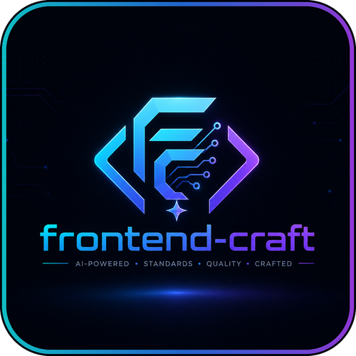

<div align="center">



# frontend-craft

### 將前端工程規範與工作流程接入你的 AI 程式設計助手。

[](https://github.com/bovinphang/frontend-craft/stargazers)
[](https://github.com/bovinphang/frontend-craft/actions/workflows/ci.yml)
[](https://www.npmjs.com/package/@bovinphang/frontend-craft)
[](../../LICENSE)


**🌐 Language / 语言 / 語言 / 言語 / 언어**

[English](../../README.md) · [简体中文](../../README.zh-CN.md) · [**繁體中文**](README.md) · [日本語](../ja-JP/README.md) · [한국어](../ko-KR/README.md)

</div>

Frontend Craft 將前端規範、設計實作、程式碼審查與測試工作流程接入 **15 款 AI 程式設計助手**。

`claude` `codex` `cursor` `windsurf` `opencode`
`kilo` `gemini` `copilot` `antigravity` `augment`
`trae` `codebuddy` `cline` `openclaw` `qoder`

完整產品提供 **74 個 Skill**（53 個前端 Skill 和 21 個共用工程 Skill）、**14 個 Agent**、**11 個命令工作流程**、**5 類 Claude Hook 事件**及 **6 個設計工具端點的 MCP 設定**，涵蓋 React、Vue、Next.js 和 Nuxt。README 提供五種語言，安裝資源支援英文與簡體中文。

各執行環境安裝其支援的能力子集。使用 `fec matrix` 查看能力矩陣，資源路徑與啟用步驟見 [Runtime 指南](../../docs/runtimes/)。

## 為什麼選擇 frontend-craft？

| 痛點 | frontend-craft 的解法 |
| --- | --- |
| AI 產生的前端程式碼風格不一、缺乏型別或安全性 | **74 個 Skill** 將團隊規範編碼為可自動啟用的工作流程 |
| 每款 AI 工具有自己的外掛格式 | **一條 CLI 指令**將相同規則、Agent 和 Hook 安裝至 15 個執行環境 |
| 設計稿交接容易遺失資訊 | **MCP 整合**從 Figma、Figma Desktop、Sketch、MasterGo、Pixso、墨刀取得完整設計脈絡 |
| 程式碼審查隨意且淺層 | **14 個 Agent** 輸出程式碼、安全、無障礙、效能、TS 與 UI 還原度分級報告 |
| 容易忘記執行 lint 和測試 | **事件驅動 Hook** 在儲存及對話結束時自動驗證 |
| 新專案每次從零開始 | **`/fec-init`** 快速建立 CLAUDE.md、規則及 settings |

---

## 核心能力

- 透過專項 Skill 套用架構、元件、狀態、API 與測試規範。
- 在支援 Agent 的宿主中進行程式碼、安全、無障礙、效能、TypeScript 與 UI 審查。
- 透過已設定的 MCP 服務讀取設計脈絡，重用既有元件和設計 Token。
- 在 Claude、Qoder 中使用適配的 Hook，OpenClaw 原生套件提供獨立 typed hooks。
- 使用 `fec project inspect . --json` 唯讀識別專案並取得任務相關能力建議。

Skill 提供工程規範與方法，Agent 執行專項任務，命令工作流程提供宿主支援的呼叫入口。終端中的 `fec setup` 接入資源，Claude Code 中的 `/fec-init` 準備專案指導設定。

## 快速開始

準備 **Node.js 22+**、已安裝的 AI 程式設計助手及既有前端專案。CLI 支援 Windows、macOS 和 Linux。

### 1. 安裝並接入助手

```sh
npm install -g @bovinphang/frontend-craft@latest
cd your-frontend-project
fec setup
```

將 `your-frontend-project` 替換為實際專案目錄。在互動終端中，`fec setup` 先讓你選擇一個或多個執行環境，再選擇英文或簡體中文資源。方向鍵移動，空白鍵勾選或取消，Enter 確認。初始勾選 Claude，只接入其他助手時先取消該選項。資源預設安裝到**目前專案**。

需要跳過互動或編寫指令碼時，明確指定執行環境、範圍與語言。以下以 Codex、Claude Code 及全部執行環境為例。

```sh
fec setup codex --local --lang zh-CN
fec setup claude --local --lang zh-CN
fec setup all --local --lang zh-CN
```

### 2. 檢查安裝結果

```sh
fec doctor codex --local
fec doctor claude --local
```

在同一專案目錄執行檢查，將 `codex` 替換為實際選擇的執行環境識別碼，多選時逐個檢查。`ok` 表示已找到預期資源，`missing` 表示需要排查的缺失資源，`not expected` 表示該適配器的能力範圍無需此資源。處理方式見 [Runtime 指南](../../docs/runtimes/)。

### 3. 完成首次任務

安裝完成後，每次 AI 對話都能使用完整的前端工程工具箱。

重新整理或重新啟動助手，開啟專案並建立新對話，確認助手發現了資源，完成宿主要求的信任或啟用操作。對於支援 Skill 的助手，將 `src/features/account` 替換為實際模組路徑後傳送以下請求。

```text
使用 fec-code-review 對 src/features/account 中的全部程式碼做唯讀審查，不修改檔案。
遵循倉庫慣例，檢查型別、渲染、狀態、無障礙與測試涵蓋率。
列出問題位置、影響及修復建議，沒有發現問題時明確說明。
```

預期取得包含問題位置與修復建議的審查結果，或明確的無問題結論。Claude Code 也提供 `/fec-review`，各宿主資源形式以 Runtime 指南為準。更多任務見[範例提示詞](../../docs/zh-CN/example-prompts.md)。

### 4. 範例提示詞

以下斜線指令以 **Claude Code** 為例，其他執行環境透過各自指令系統提供對應能力。宿主資源形式見 [Runtime 指南](../../docs/runtimes/)。

```text
合併前請審查最近的改動，重點檢查架構、型別安全、渲染、樣式、無障礙及缺少的測試。
先不要寫程式碼，請規劃帳號帳單功能，包含路由、元件邊界、資料流、狀態歸屬、驗證及上線風險。
請建立多步驟註冊表單，依框架選擇表單與 schema 驗證方案，包含上傳、條件欄位、非同步驗證及無障礙錯誤提示。
請按 Figma 節點 123:456 實作 UI，重用既有設計 Token 與元件，符合間距及響應式狀態並說明假設。
/fec-refactor-clean 請清理此模組的死碼。
/fec-smell 請診斷此模組的結構壞味道，先不要修改程式碼。
/fec-refactor-plan 請產生保持行為的小步重構計畫。
/fec-refactor 請保持可觀察行為不變地重構此模組。
```

完整情境提示詞見[提示詞庫](../../docs/zh-CN/example-prompts.md)。

## 其他安裝方式

### 臨時 npx 執行

透過 npx 使用同一接入精靈。後續 CLI 命令同樣加上 `npx @bovinphang/frontend-craft@latest` 前綴。

```sh
cd your-frontend-project
npx @bovinphang/frontend-craft@latest
npx @bovinphang/frontend-craft@latest setup

npx @bovinphang/frontend-craft@latest runtime install --local codex
npx @bovinphang/frontend-craft@latest runtime install --local claude
npx @bovinphang/frontend-craft@latest runtime install --all --local
npx @bovinphang/frontend-craft@latest runtime install --global codex
npx @bovinphang/frontend-craft@latest runtime install --global claude
npx @bovinphang/frontend-craft@latest runtime install --all --global
npx @bovinphang/frontend-craft@latest runtime install --all --dry-run --global
npx @bovinphang/frontend-craft@latest list
```

不想全域安裝 `fec` 時可使用 `npx`。不帶參數會進入互動精靈，先選執行環境，再選全域或目前專案。指令碼安裝全部執行環境時使用 `install --all --local` 或 `install --all --global`。CI 與指令碼請明確指定 `--global` / `-g` 或 `--local` / `-l`。非 TTY 且未指定時，CLI 預設為 `claude --global`。

### Claude Code Marketplace

使用 Claude Code 原生外掛時，在助手內執行以下命令，為 Claude 選擇一個啟用管道。啟用、切換與專案初始化見 [Claude 指南](../../docs/runtimes/claude.zh-CN.md)。

```text
/plugin marketplace add bovinphang/frontend-craft
/plugin install frontend-craft@frontend-craft
/reload-plugins
```

### 使用者級全域接入

跨專案使用時選擇 `--global`。以下 Codex 和 Claude Code 範例明確指定全部選項。批次接入與預設值見 [CLI 管理](../../docs/cli-management.zh-CN.md)。

```sh
fec setup codex --global --lang zh-CN
fec setup claude --global --lang zh-CN
fec setup all --global --lang zh-CN

fec runtime install --all --dry-run --global
fec list
```

### 獨立 Skill 套件

原始碼 `skills/` 維護 53 個前端 Skill，建置時組合另外 21 個共用 Skill。`pnpm run pack:skills` 從完整產物產生獨立技能套件，流程見[貢獻指南](../../CONTRIBUTING.zh-CN.md)。使用 Skills CLI 的團隊可依其文件發現倉庫中的前端 Skill。[Skills CLI 文件](https://skills.sh/docs/cli)

## 能力目錄

### 指令（Commands）

下表命令採用 Claude Code 語法。其他宿主使用適配器支援的命令或工作流程形式，報告按各工作流程慣例寫入 `reports/`。

| 指令                  | 用途                                                        | 報告                                             |
| --------------------- | ----------------------------------------------------------- | ------------------------------------------------ |
| `/fec-init`           | 初始化專案範本（CLAUDE.md、規則、settings）                 | —                                                |
| `/fec-review`         | 預設審查全專案；支援指定檔案、目錄或明確變更範圍 | `code-review-*.md`                               |
| `/fec-scaffold`       | 依規範建立 page / feature / component 樣板                  | —                                                |
| `/fec-plan`           | 統一規劃入口：實現架構或測試策略                            | `architecture-proposal-*.md` 或 `test-plan-*.md` |
| `/fec-tdd`            | 紅 → 綠 → 重構的前端 TDD 循環                               | —                                                |
| `/fec-debug`          | 前端問題診斷與修復：建置失敗、執行時錯誤、UI 異常、介面問題 | `debug-*.md`                                     |
| `/fec-refactor-clean` | 分類並安全清理死程式碼、未使用匯出、樣式和依賴              | `refactor-clean-*.md`                            |
| `/fec-smell` | Diagnose code smells without editing | `refactoring/smell-*.md` |
| `/fec-refactor-plan` | Plan behavior-preserving refactoring | `refactoring/plan-*.md` |
| `/fec-refactor` | Execute validated behavior-preserving refactoring | `refactoring/refactoring-*.md` |
| `/fec-doc-sync`       | 同步 README、docs、環境變數、腳本、API/路由說明和部署文件   | —                                                |

審查支援全專案、指定檔案或目錄，以及明確的變更範圍。單獨呼叫 `/fec-review` 預設全專案，首次任務請明確指定範圍。完整規則見[審查範圍與圖表工作流程](../../docs/zh-CN/review-and-diagram-workflows.md)。

### 技能（Skills）

完整產品包含 74 個 Skill。倉庫維護 53 個前端 Skill，建置時從 craft-common 組合 21 個共用 Skill。技能發現與啟用取決於助手和任務脈絡。

Skill 是**按任務使用**的工作流程定義，包含審查維度、輸出約定及報告格式。以下依情境列出專案規範、實作、測試、審查、設計、遷移、專案演進與文件維護能力。

**依任務使用**的工作流定義，編碼了審查維度、輸出約定和報告格式。

下方按使用場景列出常用技能，便於快速找到專案規範、實作、測試、審查、設計、遷移、專案演進和文件維護能力。

**專案規範** — 依專案框架選用：

| 技能                              | 範圍                                                  |
| --------------------------------- | ----------------------------------------------------- |
| `fec-react-project-standard`      | React + TypeScript（結構、元件、路由、狀態、API 層）  |
| `fec-vue3-project-standard`       | Vue 3 + TypeScript（結構、元件、路由、Pinia、API 層） |
| `fec-nextjs-project-standard`     | Next.js 14+ App Router、SSR/SSG、流式渲染、元資料     |
| `fec-nuxt-project-standard`       | Nuxt 3 SSR/SSG、組合式 API、資料獲取、中介軟體        |
| `fec-vite-project-standard`       | Vite 設定、環境變數安全、HMR、開發代理、建置最佳化    |
| `fec-monorepo-project-standard`   | pnpm workspace、Turborepo、Nx 結構與任務編排          |
| `cc-typescript-project-standard` | TypeScript 設定、公開型別、宣告檔、DTO 和泛型         |

**實作能力** — 建構特定前端能力時啟用：

| 技能                      | 範圍                                                       |
| ------------------------- | ---------------------------------------------------------- |
| `fec-data-fetching`       | 服務端狀態獲取、快取、失效、SSR、無限載入                  |
| `fec-api-integration`     | 型別化 API client、鑑權刷新、上傳、即時整合                |
| `fec-state-management`    | 狀態歸屬、store 選型、URL 狀態、伺服器/表單/本地狀態邊界   |
| `fec-form-handling`       | 跨框架表單選型、schema 驗證、動態欄位、上傳                |
| `fec-browser-storage`     | localStorage / sessionStorage / IndexedDB / Cookies 選型   |
| `fec-route-protection`    | React Router、Next.js、Vue Router、Nuxt 的登入態與權限路由 |
| `fec-pwa-implementation`  | manifest、Service Worker、離線快取、安裝提示               |
| `fec-web-workers`         | Web Worker、Transferable、Comlink、Worker 池               |
| `fec-canvas-threejs`      | Canvas 2D、Three.js、React Three Fiber、WebGL              |
| `fec-svg-animation`       | CSS / Framer Motion / GSAP SVG 動畫與 reduced-motion       |
| `fec-list-virtualization` | 依框架選型的大清單虛擬滾動、測量、網格和無限滾動           |

**測試** — 規劃或撰寫前端測試覆蓋時啟用：

| 技能                    | 範圍                                                      |
| ----------------------- | --------------------------------------------------------- |
| `fec-testing-strategy`  | 靜態檢查、單元、元件、整合、E2E、視覺測試分層             |
| `fec-component-testing` | React Testing Library / Vue Test Utils 元件測試與回歸用例 |
| `fec-e2e-testing`       | Playwright / Cypress E2E 與 Page Object 和 CI 整合        |
| `fec-tdd-workflow`      | 測試先行的前端實作，紅綠重構循環                          |

**審查與品質** — 程式碼審查、驗證或清理時啟用：

| 技能                           | 範圍                                                    |
| ------------------------------ | ------------------------------------------------------- |
| `fec-code-review`              | 架構、型別、渲染、樣式、可存取性審查                    |
| `fec-debug-framework`          | 系統化診斷建置、執行時、UI 和 API/資料問題              |
| `fec-security-review`          | XSS、CSRF、敏感資料外洩、輸入驗證                       |
| `fec-accessibility-check`      | WCAG 2.2、鍵盤、焦點、觸控和螢幕閱讀器行為              |
| `fec-dependency-upgrade`       | 依賴升級、lockfile 審查、CVE 修復和遷移驗證             |
| `fec-validation-fix`           | 一次性執行並修復 lint、type-check、test、build          |
| `fec-performance-optimization` | Core Web Vitals、包體、渲染、記憶體、網路與效能預算審查 |
| `fec-refactor-clean`           | 安全清理死程式碼、未使用匯出、樣式、路由和依賴          |

**Refactoring**

| Skill | Scope |
| --- | --- |
| `fec-refactoring` | Behavior-preserving refactoring capability |
| `fec-code-smells` | Behavior-preserving refactoring capability |
| `fec-refactoring-catalog` | Behavior-preserving refactoring capability |
| `fec-refactoring-functions` | Behavior-preserving refactoring capability |
| `fec-refactoring-encapsulation` | Behavior-preserving refactoring capability |
| `fec-refactoring-move-features` | Behavior-preserving refactoring capability |
| `fec-refactoring-data` | Behavior-preserving refactoring capability |
| `fec-refactoring-control` | Behavior-preserving refactoring capability |
| `fec-refactoring-api` | Behavior-preserving refactoring capability |
| `fec-refactoring-inheritance` | Behavior-preserving refactoring capability |
| `fec-refactoring-validation` | Behavior-preserving refactoring capability |

**設計 UI** — 設計實作、設計系統或視覺打磨時啟用：

| 技能                          | 範圍                                                                                             |
| ----------------------------- | ------------------------------------------------------------------------------------------------ |
| `fec-ui-design`               | 產品語境 UI 方向、反模板設計撥盤、媒體策略、狀態、視覺 QA                                        |
| `fec-image-generation`        | UI、產品和品牌視覺生成與編輯，重用共用 PNG 檢查 |
| `cc-drawio-studio`           | 可編輯 draw.io / diagrams.net 技術圖、XML/Mermaid/CSV URL 交付、形狀檢索、自動布局和程式碼結構圖 |
| `fec-web-video-presentation`  | 將文章、口播稿、課程和 demo 轉成可錄屏的 16:9 步進網頁演示                                       |
| `fec-tailwind-design-system`  | Tailwind token、主題擴展、元件變體、class 治理和暗色模式                                         |
| `fec-responsive-layout`       | 移動優先布局、容器查詢、資料密集型響應式界面                                                     |
| `fec-motion-interaction`      | 場景化動效強度、頁面轉場、滾動動畫、reduced-motion                                               |
| `fec-implement-from-design`   | 基於設計工具、截圖或分區級視覺參考實現 UI                                                        |
| `fec-storybook-component-doc` | Storybook 元件文件、設計系統呈現、隔離狀態預覽                                                   |

技術圖品質：標準時序圖、流程圖優先本機 Mermaid，可編輯架構圖優先 draw.io；工具缺少時使用 JSON/HTML。以符合 PNG 比例的實測 manifest 執行 QA，並檢視最終圖片。預設最多修復兩輪，未解決問題必須明確回報。

[審查範圍與技術圖交付指南](../zh-CN/review-and-diagram-workflows.md).

**遺留遷移** — 現代化遷移時啟用：

| 技能                             | 範圍                                           |
| -------------------------------- | ---------------------------------------------- |
| `fec-legacy-web-standard`        | JS + jQuery + HTML 傳統專案的開發與維護規範    |
| `fec-legacy-to-modern-migration` | 遺留前端現代化、目標技術棧識別與分階段遷移流程 |

**專案演進** — 吸收參考系統並原創化落到目前專案時啟用：

| 技能          | 範圍                                       |
| ------------- | ------------------------------------------ |
| `fec-alchemy` | 將參考系統能力原創化吸收到目前專案原生體系 |

**文件維護** — 文件維護時啟用：

| 技能                               | 範圍                                                                  |
| ---------------------------------- | --------------------------------------------------------------------- |
| `fec-backend-requirements-handoff` | 前端向後端交接 UI 資料需求、使用者動作、狀態、業務規則與待確認問題    |
| `fec-doc-sync`                     | 讓前端文件與程式碼、設定、腳本、路由、API、環境變數和部署事實保持同步 |
| `cc-source-driven-development`    | 以專案事實和官方來源驗證版本敏感的前端決策                            |

### 代理（Agents）

Claude、Codex 和 Qoder 支援安裝 Agent，下表列出可用角色。

| 代理                        | 聚焦領域                                                  | 報告                         |
| --------------------------- | --------------------------------------------------------- | ---------------------------- |
| `fec-code-reviewer`         | React/Vue/Next/Nuxt、TS、樣式、用戶端安全（按置信度降噪） | `code-review-*.md`           |
| `fec-typescript-reviewer`   | 型別安全、非同步正確性、慣用模式（只報告不修改）          | `typescript-review-*.md`     |
| `fec-security-reviewer`     | XSS、用戶端金鑰、危險 DOM/API、CSP、依賴稽核              | `security-review-*.md`       |
| `fec-performance-optimizer` | 打包體積、渲染效能、網路瓶頸                              | `performance-review-*.md`    |
| `fec-architect`             | 頁面拆分、元件架構、狀態流、目錄規劃                      | `architecture-proposal-*.md` |
| `fec-test-planner`          | 風險-層級映射：靜態、單元、元件、E2E、視覺、無障礙、安全  | `test-plan-*.md`             |
| `fec-debugger`              | 複雜前端診斷：建置、執行時、UI 和介面問題                 | `debug-*.md`                 |
| `fec-refactor-cleaner`      | 分類並安全清理未使用程式碼、匯出、樣式、路由和依賴        | `refactor-clean-*.md`        |
| `fec-refactoring-expert` | Behavior-preserving refactoring orchestration | `refactoring/refactoring-*.md` |
| `fec-e2e-runner`            | E2E 撰寫與執行（Playwright/Cypress）、flaky 隔離、Trace   | `e2e-summary-*.md`           |
| `fec-doc-updater`           | 同步 README、runtime 文件、結構、能力表和 metadata        | —                            |
| `fec-ui-checker`            | 視覺問題排查與設計還原度評估                              | `ui-fidelity-review-*.md`    |
| `fec-figma-implementer`     | 依 Figma/Sketch/MasterGo/Pixso/墨刀設計稿精確實作 UI      | `design-implementation-*.md` |
| `fec-design-token-mapper`   | 將設計變數對應至專案 Design Token                         | `token-mapping-*.md`         |

### Hook、設計工具與專案範本

Claude 和 Qoder 適配器安裝支援的 Hook，Codex 安裝 Skill、Agent、規則與範本。MCP 設定及憑證按宿主接入，OpenClaw 原生套件有獨立 typed hooks。步驟見[設定與報告指南](../../docs/zh-CN/configuration.md)及 [Runtime 指南](../../docs/runtimes/)。

## 設定與報告

依宿主設定設計工具 MCP 與 Hook。[設定指南](../../docs/zh-CN/configuration.md)介紹權杖變數、Hook 行為與報告檔名。工作流程依慣例在 `reports/` 寫入含時間戳記的 Markdown 報告，是否提交由團隊決定。

## 更新與解除安裝

`fec update` 升級經來源驗證的 npm/pnpm 全域 CLI，並更新目前專案與使用者全域的受管資源。`fec runtime update` 使用目前套件更新資源，預設保留各安裝的語言。資源更新保護使用者修改。

```sh
fec update --dry-run
fec update
fec runtime update codex --local
fec runtime uninstall codex --local --dry-run
fec runtime uninstall codex --local
fec uninstall --yes
```

`fec runtime uninstall` 移除清單管理的資源，預設保留使用者修改。`fec uninstall --yes` 解除安裝全域 CLI，加上 `--purge` 可先清理發現的受管資源。來源要求、預覽與失敗復原見 [CLI 管理](../../docs/cli-management.zh-CN.md)，共用資源衝突見[遷移指南](../../docs/zh-CN/common-migration.md)。

## 文件導覽

- [Runtime 指南](../../docs/runtimes/)
- [CLI 管理](../../docs/cli-management.zh-CN.md)
- [範例提示詞](../../docs/zh-CN/example-prompts.md)
- [設定與報告](../../docs/zh-CN/configuration.md)
- [審查範圍與圖表](../../docs/zh-CN/review-and-diagram-workflows.md)
- [重構指南](../../docs/refactoring/README.md)
- [共用資源遷移](../../docs/zh-CN/common-migration.md)
- [完整文件索引](../../docs/README.zh-CN.md)

## 原始碼開發與貢獻

本倉庫維護前端 Skill、Agent 與工作流程，共用 `cc-*` Skill 與工程方法在 [craft-common](https://github.com/bovinphang/craft-common) 統一維護。`pnpm build` 在 `dist/package/` 產生完整英文與簡體中文產品。使用 Node.js 22+ 和 `package.json` 指定的 pnpm，相依版本以 `package.json` 與 `pnpm-lock.yaml` 為準。

```sh
git clone https://github.com/bovinphang/frontend-craft.git
cd frontend-craft
pnpm install --frozen-lockfile
pnpm build
node dist/package/dist/bin/frontend-craft.js list --json
```

在倉庫根目錄執行以下命令，載入組合後的 Claude 外掛。

```sh
claude --plugin-dir ./dist/package
```

開發檢查、多語言維護及發行封存檔（`pnpm run pack:all`）見[貢獻指南](../../CONTRIBUTING.zh-CN.md)。

## 社群

- [貢獻指南](../../CONTRIBUTING.md) — 開發環境、PR 檢查清單與多語言同步規則（[简体中文](../../CONTRIBUTING.zh-CN.md)）
- [安全政策](../../SECURITY.md) — 私密漏洞回報方式與支援範圍（[简体中文](../../SECURITY.zh-CN.md)）
- [行為準則](../../CODE_OF_CONDUCT.md) — 社群參與規範（[简体中文](../../CODE_OF_CONDUCT.zh-CN.md)）
- [變更日誌](../../CHANGELOG.md) — 版本說明（[简体中文](../../CHANGELOG.zh-CN.md)）
- [專案結構](../project-structure.md) — 完整目錄佈局與檔案職責

**如果 frontend-craft 幫助了你的團隊，[請給它一個 Star](https://github.com/bovinphang/frontend-craft)。**

## 授權條款

[MIT](../../LICENSE) © bovinphang。
